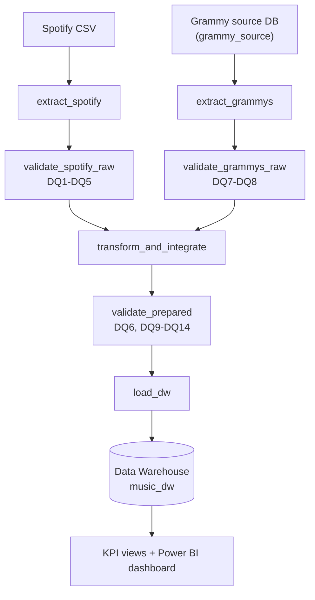
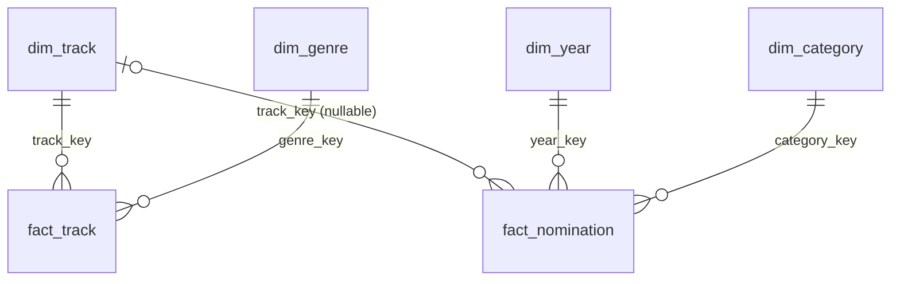
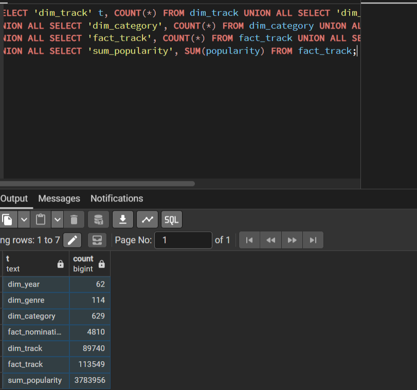
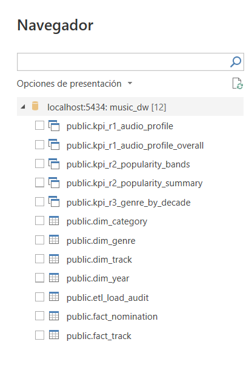

# Workshop 2 - Building a Reliable Batch Data Pipeline

**Course:** ETL (G01) - Data Engineering and Artificial Intelligence, Universidad Autónoma de Occidente  
**Scenario:** Integrate Spotify data (CSV) and Grammy Awards data (relational source database) into a trusted dimensional Data Warehouse.  
**Stack:** Apache Airflow 3.1.8 (TaskFlow API, Docker Compose) - Great Expectations 1.x - PostgreSQL 16 - Python / pandas - Power BI  

> **Engineering principle of this repository.** A data pipeline does not assume that data is correct, it verifies it.  
> Reliable does not mean that nothing fails: it means that failures are anticipated, controlled and observable.

---

## Contents

1. [Problem and analytical objective](#1-problem-and-analytical-objective)
2. [Analytical requirements](#2-analytical-requirements)
3. [Data sources](#3-data-sources)
4. [Pipeline architecture](#4-pipeline-architecture)
5. [Data profiling findings](#5-data-profiling-findings)
6. [Quality risks and quality rules](#6-quality-risks-and-quality-rules)
7. [Great Expectations validation design](#7-great-expectations-validation-design)
8. [Transformation and integration strategy](#8-transformation-and-integration-strategy)
9. [Dimensional model](#9-dimensional-model)
10. [Airflow DAG design](#10-airflow-dag-design)
11. [Failure and retry policy](#11-failure-and-retry-policy)
12. [Successful execution evidence (Test A)](#12-successful-execution-evidence-test-a)
13. [Controlled failure evidence (Test B and Test B2)](#13-controlled-failure-evidence-test-b-and-test-b2)
14. [Repeatability strategy (safe rerun)](#14-repeatability-strategy-safe-rerun)
15. [Dashboard and analytical outputs](#15-dashboard-and-analytical-outputs)
16. [Setup and execution instructions (how to replicate)](#16-setup-and-execution-instructions-how-to-replicate)
17. [Assumptions and limitations](#17-assumptions-and-limitations)
18. [Traceability matrix, evidence register, requirement audit and checklist](#18-traceability-matrix-evidence-register-requirement-audit-and-checklist)

Detailed design documents: `docs/quality_rules.md`, `docs/transformation_integration.md`, `docs/dimensional_model.md`, `docs/powerbi_dashboard_guide.md`.

---

## 1. Problem and analytical objective

Spotify describes **what people listen to** (audio characteristics, popularity, genre). The Grammy Awards describe **what the industry recognizes** (nominations by category and year). Each source answers half of an analytical question: *is critical industry recognition related to how a song sounds, how popular it is, and which genres it belongs to?* Neither source can answer it alone, so the project integrates them.

The objective is not only the analysis but the **system** that produces it: a batch pipeline that extracts both sources, validates them automatically at two distinct gates (raw and prepared), transforms and integrates them under a documented contract, loads a dimensional Data Warehouse safely (reruns never duplicate data), and exposes KPIs through views that query the warehouse directly.

---

## 2. Analytical requirements

| ID | Analytical requirement | Required data | Source(s) | Expected KPI(s) | Required level of detail |
|---|---|---|---|---|---|
| **R1** | Does the audio profile of Grammy-nominated songs differ from the rest of the Spotify catalog, by genre? | `danceability`, `energy`, `valence`, `acousticness`, `tempo` + `track_genre` (Spotify); `nominee`, `artist`, `year` (Grammy) | Both | KPI-1: average of each audio feature, nominated vs not | Genre; track-genre row |
| **R2** | Is a song's Spotify popularity related to being nominated? | `popularity`, `track_id` (Spotify); `nominee`, `artist`, `year`, `category` (Grammy) | Both | KPI-2: average and median popularity; share of tracks with popularity >= 50 | One value per track |
| **R3** | Which genres appear most among nominated songs, and how does that change over time? | `track_genre` (Spotify); `nominee`, `artist`, `year` (Grammy) | Both | KPI-3: nominations per genre and decade | Decade x genre |

**Why both sources are necessary.** The nomination flag exists only in Grammy; audio features, popularity, and genre exist only in Spotify. Every requirement compares an attribute of one source across a group defined by the other.

**Scope statement.** The integration links a Grammy nomination to a Spotify track when title and primary artist agree. Most Grammy categories (albums, producers, composers, classical works) are not individual tracks, and 38% of Grammy rows have no artist, so **263 of 4,810 nominations (5.5%)** can be linked. Unlinked nominations are kept in the warehouse (with a NULL track key); the three requirements are answered over the linked ones. This is a defined scope, not a hidden limitation.

---

## 3. Data sources

| Source | Provided as | How the pipeline reads it | Size |
|---|---|---|---|
| Spotify catalog | `data/spotify_dataset.csv` | Read directly from the CSV file (`extract_spotify`) | 114,000 rows, 21 columns, 114 genres |
| Grammy Awards | `data/the_grammy_awards.csv` | **Loaded once** into the relational source database `grammy_source.grammy_awards_raw` (`src/prepare_source.py`). The pipeline reads it **from the database** (`extract_grammys`), never from the CSV | 4,810 rows, 10 columns, years 1958-2019 |

Source preparation is **not** the ETL load: it creates the operational source for extraction and reconciles the row count (CSV = table = 4,810). The final load writes validated prepared data into a different database, the Data Warehouse `music_dw`. Original input files are never modified.

**Source preparation record**

| Item | Detail |
|---|---|
| Import process | `src/prepare_source.py`: reads the CSV with pandas, (re)creates the table from `sql/source_setup.sql`, inserts in chunks of 1,000, then reconciles counts |
| Table definition | `grammy_awards_raw` (`sql/source_setup.sql`): `row_id SERIAL PRIMARY KEY` plus 10 source columns (`year INTEGER`, text columns, `published_at` / `updated_at` `TIMESTAMP`, `winner BOOLEAN`) |
| Row-count reconciliation | CSV 4,810 = table 4,810; a mismatch exits with code 1 and prints `RECONCILIATION FAILED` |
| Decisions | Loaded **as is**, with no cleaning, so source-quality problems stay visible to the raw gate. A surrogate `row_id` gives every source row a stable identifier (`nomination_id`). Idempotent: table is dropped and recreated, so rerunning never duplicates rows |

---

## 4. Pipeline architecture



| Layer | Component | Responsibility |
|---|---|---|
| Orchestration | `dags/reliable_music_pipeline.py` | Workflow structure, dependencies, retry and failure policy using Airflow TaskFlow API |
| Reusable logic | `src/extract.py`, `validation.py`, `transform.py`, `load.py`, `db.py` | Extraction, validation, transformation, load (testable without Airflow) |
| Quality design | Profiling -> quality risks -> quality rules -> Great Expectations -> validation gates | Sections 5-7 |
| Reliability controls | Dependencies, selective retries, logs, controlled failure, atomic idempotent load | Sections 10-14 |
| Infrastructure | `docker-compose.yaml` | Airflow 3.1.8 (API server, scheduler, triggerer, worker, Redis, metadata DB) + PostgreSQL 16 (`music_postgres`) |

**Task interfaces.** Tasks exchange only compact metadata (file paths, batch id, row counts, rule ids). Bulk data moves through staging parquet files in `data/staging/<run_id>/`; Airflow's metadata database is never used as a data transport.

---

## 5. Data profiling findings

Reproducible notebook: `notebooks/data_profiling.ipynb` (executed, outputs included). Profiling only observes; it never alters data.

| Dataset / attribute | Profiling evidence | Potential quality risk | Related requirement |
|---|---|---|---|
| Spotify `duration_ms` | 1 row of 114,000 equals 0 | Impossible value | R1-R3 (DQ1) |
| Spotify `track_name`, `artists` | The same single row has them null | Missing match key | R1-R3 (DQ3) |
| Spotify audio features, `popularity` | All within [0,1] / [0,100] | Source schema or unit change would break them | R1, R2 (DQ2, DQ4) |
| Spotify `track_id` + `track_genre` | 24,259 repeated `track_id` (a song tagged under several genres: expected); 450 exact repeated pairs | Double counting in averages and genre counts | R1, R3 (DQ5) |
| Grammy `artist` | 1,840 nulls (38.3%) | Nomination can never be matched | Scope of R1-R3 |
| Grammy `category` | 638 labels; 9 are redundant spellings (case, spacing, wording) | One category split into several | R3 (DQ6) |
| Grammy `winner` | `True` in 100% of rows. Up to 2 rows per category-year before 2011, up to 8 from 2011 | The flag does not identify the winner among nominees | Evidence only (DQ8) |
| Cross-source | A naive join on (title, artist) returns 443 rows for 181 distinct nominations; real match rate is 5.5% | Fan-out inflates `FactNomination` | R2, R3 (DQ9, DQ10) |

---

## 6. Quality risks and quality rules

Fourteen rules, each justified by profiling evidence, an analytical requirement, or a post-transformation invariant. Full specification in **`docs/quality_rules.md`**.

| Rule | Layer | What must be true | Threshold | Severity |
|---|---|---|---|---|
| DQ1 | Spotify raw | `duration_ms` > 0 | <= 0.1% violations | Critical |
| DQ2 | Spotify raw | `popularity` in [0,100] | 0 | Critical |
| DQ3 | Spotify raw | `track_name`, `artists` not null | <= 0.1% nulls | Critical |
| DQ4 | Spotify raw | 7 audio features in [0,1] | 0 | Critical |
| DQ5 | Spotify raw | (`track_id`, `track_genre`) unique | 0 duplicates | Warning |
| DQ6 | Prepared | `category_normalized` non-null and one label per category | 0 | Critical |
| DQ7 | Grammy raw | `year` in [1958, 2026] | 0 | Critical |
| DQ8 | Grammy raw | `winner` reliable (single-row groups) | >= 70% of rows (observed 89.7%) | Warning |
| DQ9 | Prepared | Match rate within observed band | 4%-15% (observed 5.5%) | Informational |
| DQ10 | Prepared | One prepared row per source nomination (no join fan-out) | 0 duplicates | Critical |
| DQ11 | Prepared | (`track_id`, `track_genre`) unique after dedup | 0 | Critical |
| DQ12 | Prepared | Every matched `track_id` exists in prepared tracks | 0 orphans | Critical |
| DQ13 | Prepared | Required columns present | 0 missing | Critical |
| DQ14 | Prepared | After quarantine, no `duration_ms <= 0` and no null match key | 0 | Critical |

**Severity policy.** Critical: task fails and downstream path is blocked (no retry). Warning: logged and recorded, pipeline continues. Informational: recorded for monitoring.

---

## 7. Great Expectations validation design

Implemented in `src/validation.py`. One gate = one Checkpoint run over a whole-DataFrame batch.

| Design element | Implementation |
|---|---|
| Expectation | One GX check per declared rule; `meta` carries `rule_id` and `severity` |
| Expectation Suites | `spotify_raw_suite`, `grammy_raw_suite`, `prepared_tracks_suite`, `prepared_nominations_suite` |
| Validation Definitions | `<prefix>_validation` = suite + whole-DataFrame batch definition |
| Checkpoints | `<prefix>_checkpoint`, run by validation functions |
| Validation result | JSON in `results/validation/<run_id>__<suite>.json` |
| Policy | Evaluated **per rule**, not through GX's global `success` |

Rule -> Expectation mapping:

| Rule | Suite | GX Expectation |
|---|---|---|
| DQ1 | `spotify_raw_suite` | `ExpectColumnValuesToBeBetween(duration_ms, min_value=0, strict_min=True, mostly=0.999)` |
| DQ2 | `spotify_raw_suite` | `ExpectColumnValuesToBeBetween(popularity, 0, 100)` |
| DQ3 | `spotify_raw_suite` | `ExpectColumnValuesToNotBeNull(track_name, artists; mostly=0.999)` |
| DQ4 | `spotify_raw_suite` | `ExpectColumnValuesToBeBetween(<7 audio features>, 0, 1)` |
| DQ5 | `spotify_raw_suite` | `ExpectCompoundColumnsToBeUnique(track_id, track_genre)` |
| DQ6 | `prepared_nominations_suite` | `ExpectColumnValuesToNotBeNull(category_normalized)` + `ExpectColumnValuesToBeInSet(category_label_consistent, [True])` |
| DQ7 | `grammy_raw_suite` | `ExpectColumnValuesToBeBetween(year, 1958, 2026)` |
| DQ8 | `grammy_raw_suite` | `ExpectColumnValuesToBeInSet(winner_flag_reliable, [True], mostly=0.70)` |
| DQ9 | `prepared_nominations_suite` | `ExpectColumnMeanToBeBetween(is_matched_to_spotify_int, 0.04, 0.15)` |
| DQ10 | `prepared_nominations_suite` | `ExpectColumnValuesToBeUnique(grammy_row_id)` |
| DQ11 | `prepared_tracks_suite` | `ExpectCompoundColumnsToBeUnique(track_id, track_genre)` |
| DQ12 | `prepared_nominations_suite` | `ExpectColumnValuesToBeInSet(fk_valid, [True])` |
| DQ13 | both prepared suites | `ExpectTableColumnsToMatchSet(<required columns>, exact_match=False)` |
| DQ14 | `prepared_tracks_suite` | `ExpectColumnValuesToBeBetween(duration_ms, strict_min=0)` + `ExpectColumnValuesToNotBeNull(track_name, artists)` |

---

## 8. Transformation and integration strategy

Implemented in `src/transform.py`; decision record in `docs/transformation_integration.md`.

| ID | Rule | Evidence | Effect |
|---|---|---|---|
| T1 | Drop `Unnamed: 0` column | Index artifact | 21 -> 20 columns |
| T2 | **Quarantine** rows with `duration_ms <= 0` or null keys | DQ1, DQ3 | 1 row quarantined |
| T3 | Deduplicate (`track_id`, `track_genre`), keep highest popularity | DQ5 | 450 duplicates removed |
| T4 | Normalize Grammy category labels (case, spacing) | DQ6 | 638 -> 629 categories |
| T5 | Derive `is_confirmed_winner` | DQ8 | 4,315 confirmed winners |
| T6 | Integrate Grammy with Spotify | R1-R3 | 263 nominations linked |

**Integration contract**

| Item | Decision |
|---|---|
| Keys | Spotify `track_name` + `artists` <-> Grammy `nominee` + `artist` |
| Strategy | Two tiers in `match_type`: **exact** then **normalized** (title clean, primary artist) |
| Cardinality | Many-to-one (each nomination maps to at most one track) |
| Unmatched | 4,547 of 4,810 (94.5%) kept with NULL track key |
| Duplicate matches | 79 linked nominations had multiple candidates: highest popularity wins, flagged `match_ambiguous` |

**Reconciliation evidence**:
- Spotify: 114,000 = 113,549 prepared + 1 quarantined + 450 duplicates removed
- Grammy: 4,810 = 4,810 prepared
- Matches: exact (181) + normalized (82) + none (4,547) = 4,810

---

## 9. Dimensional model

Executable schema: `sql/dw_schema.sql`. Documentation: `docs/dimensional_model.md`.

Fact constellation with **two facts sharing the conformed dimension `dim_track`**:

| Fact / Dimension | Grain / Description | Keys | Rows |
|---|---|---|---|
| `fact_track` | One track under one genre tag | PK (`track_key`, `genre_key`) | 113,549 |
| `fact_nomination` | One nomination (linked or unlinked) | PK `nomination_id`, FK `track_key` (nullable) | 4,810 |
| `dim_track` | Conformed track identity | PK `track_key`, BK `track_id` | 89,740 |
| `dim_genre` | Spotify genre | PK `genre_key`, BK `genre_name` | 114 |
| `dim_category` | Grammy category | PK `category_key`, BK `category_name` | 629 |
| `dim_year` | Ceremony year | PK `year` | 62 |



---

## 10. Airflow DAG design

`dags/reliable_music_pipeline.py` (DAG `reliable_music_pipeline`, TaskFlow API using `from airflow.sdk import dag, task`).

| Task | Module | Retries | Rationale |
|---|---|---|---|
| `extract_spotify` | `src.extract` | 1 (15s) | Transient file I/O |
| `extract_grammys` | `src.extract` | 3 (backoff) | DB connection transient outage |
| `validate_spotify_raw` | `src.validation` | 0 | Deterministic gate |
| `validate_grammys_raw` | `src.validation` | 0 | Deterministic gate |
| `transform_and_integrate` | `src.transform` | 0 | Deterministic computation |
| `validate_prepared` | `src.validation` | 0 | Deterministic gate |
| `load_dw` | `src.load` | 2 (1 min) | Network retry only; atomic transaction |

---

## 11. Failure and retry policy

| Failure class | Policy | Retries | Justification |
|---|---|---|---|
| Transient DB error | Retry with backoff | 2-3 | Can recover on next attempt |
| Critical rule failure | Stop pipeline immediately | 0 | Deterministic data defect |
| Warning rule failure | Record log, continue | n/a | Non-blocking quality concern |
| Reconciliation error | Fail transformation task | 0 | Integrity breach |

---

## 12. Successful execution evidence (Test A)

Full end-to-end execution on valid data. All 7 tasks completed successfully.


*Figure 12.1: Airflow Grid View showing end-to-end success across all 7 pipeline tasks.*


*Figure 12.2: Verification query on PostgreSQL `music_dw` showing exact row counts across facts and dimensions.*

**Verified Row Counts:**
- `dim_track`: 89,740
- `dim_genre`: 114
- `dim_category`: 629
- `dim_year`: 62
- `fact_track`: 113,549
- `fact_nomination`: 4,810
- `etl_load_audit`: 1 record (`status = 'SUCCESS'`)

---

## 13. Controlled failure evidence (Test B and Test B2)

### Test B: Raw Gate Critical Failure
Triggered with `inject_spotify_fault = spotify_duration_ms_zero` (5% duration_ms = 0).


*Figure 13.1: Grid View showing `validate_spotify_raw` failed (try 1/1, no retry) and downstream tasks blocked (`upstream_failed`).*


*Figure 13.2: Task instances list confirming zero retries for deterministic data failure and independent execution of Grammy branch.*


*Figure 13.3: Failed task log recording Critical rule `DQ1` violation (5,701 invalid rows = 5.00%).*

### Test B2: Prepared Gate Critical Failure
Triggered with `inject_prepared_fault = join_fanout` (simulating join duplication bug).


*Figure 13.4: Prepared gate failure blocking `load_dw` due to rule `DQ10` violation.*


*Figure 13.5: `validate_prepared` log showing rejection of duplicated nominations, protecting `music_dw` from corruption.*

---

## 14. Repeatability strategy (safe rerun)

**Strategy:** Atomic replace (truncate-and-load inside a single SQL transaction).


*Figure 14.1: Initial Data Warehouse snapshot baseline.*


*Figure 14.2: Successful rerun execution yielding identical row counts without duplication.*


*Figure 14.3: SQL verification showing row counts and `SUM(popularity)` before and after rerun.*


*Figure 14.4: `etl_load_audit` log demonstrating transactional load tracking.*

| Table / Metric | Initial Load (Test A) | Rerun Load | Aborted Load | Post-Recovery Load |
|---|---|---|---|---|
| `fact_track` | 113,549 | 113,549 | 113,549 (rolled back) | 113,549 |
| `fact_nomination` | 4,810 | 4,810 | 4,810 (rolled back) | 4,810 |
| `SUM(popularity)` | 3,783,956 | 3,783,956 | 3,783,956 | 3,783,956 |
| `etl_load_audit` entries | 1 SUCCESS | 2 SUCCESS | 2 SUCCESS, 1 FAILED | 3 SUCCESS, 1 FAILED |

---

## 15. Dashboard and analytical outputs

Direct connection to `music_dw` via PostgreSQL views (`kpi_r1_audio_profile_overall`, `kpi_r2_popularity_summary`, `kpi_r3_genre_by_decade`).


*Figure 15.1: Power BI Direct PostgreSQL connection configuration.*


*Figure 15.2: Power BI view selection from `music_dw` database.*


*Figure 15.3: Executive Power BI Dashboard answering analytical requirements R1, R2, and R3.*

### KPI-1 (R1): Audio Profile Comparison

*Figure 15.4: Audio characteristics comparison between Grammy-nominated songs and catalog rest.*

### KPI-2 (R2): Popularity Distribution

*Figure 15.5: Popularity distribution comparing nominated tracks (avg 59.1) vs rest (avg 33.1).*

### KPI-3 (R3): Genre Evolution by Decade

*Figure 15.6: Evolution of top nominated genres across decades (1950s - 2010s).*

---

## 16. Setup and execution instructions (how to replicate)

### Prerequisites
- Docker Desktop with at least 4 GB RAM and 2 CPUs.
- Ports 8080 (Airflow) and 5433 (PostgreSQL `music_postgres`) free.

### Step-by-Step Execution

```bash
# 1. Environment configuration
cp .env.example .env

# 2. Build Airflow image with Great Expectations
docker compose build

# 3. Initialize database metadata
docker compose up airflow-init

# 4. Start the stack
docker compose up -d

# 5. Execute Source Preparation (Grammy CSV -> Source Database)
docker compose exec airflow-scheduler python /opt/airflow/src/prepare_source.py

# 6. Check Airflow UI
# Navigate to http://localhost:8080 (user: airflow, pass: airflow)
# Trigger DAG: reliable_music_pipeline
```

### Verification Query

```bash
docker compose exec music_postgres psql -U music_user -d music_dw -c \
"SELECT 'fact_track' t, COUNT(*) FROM fact_track UNION ALL SELECT 'fact_nomination', COUNT(*) FROM fact_nomination;"
```

---

## 17. Assumptions and limitations

1. **Match Precision:** Matching is performed on normalized title and primary artist. Unmatched nominations (94.5%) remain in `fact_nomination` with `track_key = NULL`.
2. **Grammy Nominees Grain:** Only track-level nominations can be matched. Albums, producers, and classical categories remain unlinked by design.
3. **Temporal Snapshots:** Popularity reflects current Spotify API state, whereas Grammy awards represent historical years (1958–2019).
4. **Full Reload Pattern:** Safe rerun relies on atomic replace; incremental delta processing is out of scope.

---

## 18. Traceability matrix, evidence register, requirement audit and checklist

### 18.1 Traceability Matrix

| Requirement | Required Data | Quality Risk | DQ Rule | GX Expectation | Transformation | DW Element | KPI / Output |
|---|---|---|---|---|---|---|---|
| R1 | Audio features, genre, nomination | Zero duration, features out of bounds | DQ1, DQ4, DQ5, DQ11, DQ14 | `ExpectColumnValuesToBeBetween` | T2 Quarantine, T3 Dedup, T6 Join | `fact_track`, `dim_genre` | KPI-1 Bar Chart |
| R2 | Popularity, track_id, nomination | Popularity out of range, join fan-out | DQ2, DQ10, DQ12 | `ExpectColumnValuesToBeUnique` | T3 Candidate rank | `fact_track`, `fact_nomination` | KPI-2 Cards & Histogram |
| R3 | Genre, year, category | Unnormalized labels, orphan keys | DQ6, DQ7, DQ12 | `ExpectColumnValuesToBeInSet` | T4 Category norm | `dim_year`, `dim_category` | KPI-3 Stacked Chart |

### 18.2 Reliability Evidence Register

| Evidence ID | Component | Relative File Path | What It Proves | Status |
|---|---|---|---|---|
| **E-U0** | Docker Setup | `docs/evidence/user_runs/first_docker_run_load_dw_failure.txt` | Error visibility on uninitialized DW | Complete |
| **E-U1** | Test A | `docs/evidence/user_runs/testA_airflow_grid_view.png` | Successful 7-task DAG execution | Complete |
| **E-U1b** | Test A DW | `docs/evidence/user_runs/testA_dw_row_counts.png` | Target DW table verification | Complete |
| **E-U2** | Test B UI | `docs/evidence/user_runs/testB_failed_run_grid_view.png` | Raw gate blocking pipeline | Complete |
| **E-U2b** | Test B Inst | `docs/evidence/user_runs/testB_failed_run_task_instances.png` | No retries for deterministic failure | Complete |
| **E-U2c** | Test B Log | `docs/evidence/user_runs/testB_failed_task_log.png` | DQ1 critical failure log details | Complete |
| **E-U5** | Test B2 UI | `docs/evidence/user_runs/testB2_prepared_gate_grid_view.png` | Prepared gate blocking load | Complete |
| **E-U5b** | Test B2 Log | `docs/evidence/user_runs/testB2_failed_task_log.png` | DQ10 fan-out protection log | Complete |
| **E-U3** | Rerun Inst | `docs/evidence/user_runs/rerun_success_run_task_instances.png` | Safe rerun execution | Complete |
| **E-U3b** | Rerun SQL | `docs/evidence/user_runs/safe_rerun_before_after_comparison.png` | Zero duplicate rows after rerun | Complete |
| **E-U3c** | Audit SQL | `docs/evidence/user_runs/etl_load_audit_history.png` | Transactional load audit trail | Complete |
| **E-U7** | Extraction | `docs/evidence/user_runs/grammy_source_extraction_log.png` | Extraction from DB, not CSV | Complete |
| **E-U4** | Power BI | `docs/figures/powerbi_dashboard_overview.png` | Full analytical dashboard | Complete |

### 18.3 Minimum Evidence Set Checklist

- [x] Analytical-requirement table and scope definition (Section 2)
- [x] Architecture & Mermaid DAG workflow diagram (Section 4)
- [x] Data profiling notebook (`notebooks/data_profiling.ipynb`)
- [x] Quality rules & GX design (Sections 6 & 7)
- [x] Integration contract & reconciliation (Section 8)
- [x] Dimensional model schema (`sql/dw_schema.sql`)
- [x] Test A Successful Run evidence (Section 12)
- [x] Test B Controlled Failure evidence (Section 13)
- [x] Test B2 Prepared Gate Failure evidence (Section 13)
- [x] Selective Retry policy & justification (Section 10 & 11)
- [x] Repeatability & Safe Rerun evidence (Section 14)
- [x] Power BI DW Connection & KPIs (Section 15)

---

### 18.4 Requirement Compliance & Audit Status

This table audits every requirement from the official course specification (`ETL_2026-2_Workshop-2.pdf`) against the repo implementation:

| PDF Brief Requirement | Implemented Component | Repository Compliance Status | Action required to finalize submission |
|---|---|---|---|
| **Airflow 3.1.8 TaskFlow API** | `dags/reliable_music_pipeline.py` | **100% Implemented** (`from airflow.sdk import dag, task`) | None |
| **Grammy extracted from DB** | `src/prepare_source.py`, `src/extract.py` | **100% Implemented** (CSV loaded to source DB once; pipeline extracts via SQL query) | Keep screenshot `grammy_source_extraction_log.png` in place |
| **Great Expectations Raw/Prepared Gates** | `src/validation.py` | **100% Implemented** (2 gates, 4 suites, 14 rules) | None |
| **Dimensional Star Schema** | `sql/dw_schema.sql` | **100% Implemented** (`fact_track`, `fact_nomination`, conformed `dim_track`) | None |
| **Test A Execution** | DAG Run Default | **100% Implemented** | Ensure `testA_airflow_grid_view.png` and `testA_dw_row_counts.png` are uploaded |
| **Test B Raw Controlled Failure** | Fault injection parameter | **100% Implemented** (`inject_spotify_fault`) | Ensure `testB_failed_run_grid_view.png` and `testB_failed_task_log.png` are uploaded |
| **Test B2 Prepared Gate Failure** | Fault injection parameter | **100% Implemented** (`inject_prepared_fault`) | Ensure `testB2_prepared_gate_grid_view.png` and `testB2_failed_task_log.png` are uploaded |
| **Safe Rerun / Repeatability** | Atomic Replace | **100% Implemented** (`TRUNCATE` + Load in single transaction) | Ensure `safe_rerun_before_after_comparison.png` is uploaded |
| **Power BI Dashboard from DW** | `dashboard/music_dashboard.pbix`, SQL views | **100% Implemented** (3 KPIs directly from DW views) | Ensure `powerbi_dashboard_overview.png` is uploaded |

---

## Repository structure

```
workshop-2/
|-- dags/reliable_music_pipeline.py     DAG (TaskFlow API): structure, dependencies, retries, failure policy
|-- src/                                extract.py, validation.py, transform.py, load.py, prepare_source.py, db.py
|-- gx/                                 Great Expectations context and suites
|-- notebooks/data_profiling.ipynb      Reproducible profiling notebook
|-- sql/                                source_setup.sql, dw_schema.sql, kpi_queries.sql, init_music_dbs.sql
|-- docs/                               quality_rules.md, transformation_integration.md, dimensional_model.md, powerbi_dashboard_guide.md, figures/, evidence/
|-- data/                               spotify_dataset.csv, the_grammy_awards.csv (original input files)
|-- dashboard/                          Power BI report (music_dashboard.pbix) connected to DW views
|-- results/                            Written by pipeline: validation/ and reconciliation/ JSON evidence
|-- requirements.txt  Dockerfile  docker-compose.yaml  .env.example  .gitignore  README.md
```

**Author:** Samuel Izquierdo Bonilla  
**Course:** ETL (G01) - Universidad Autónoma de Occidente  