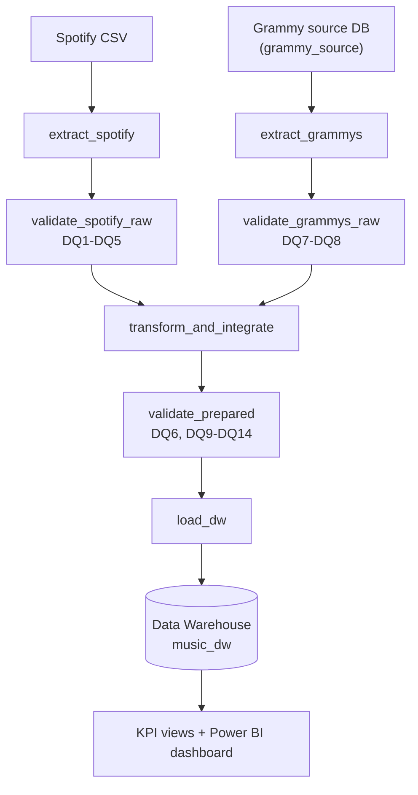
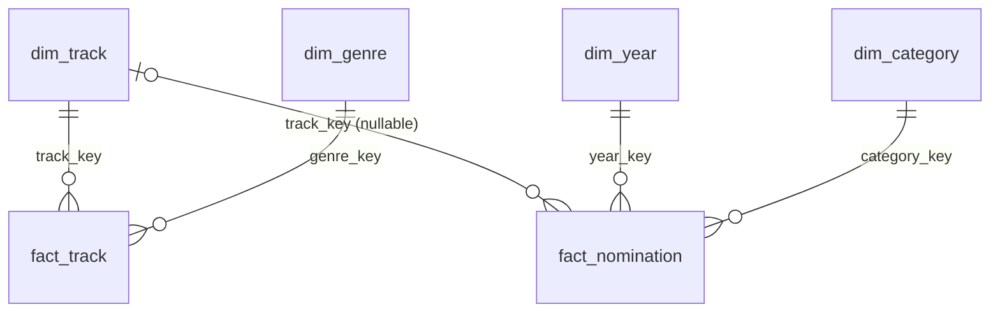

# Workshop 2 - Building a Reliable Batch Data Pipeline

**Course:** ETL (G01) - Data Engineering and Artificial Intelligence, Universidad Autonoma de Occidente
**Scenario:** integrate Spotify data (CSV) and Grammy Awards data (relational source database) into a trusted dimensional Data Warehouse.
**Stack:** Apache Airflow 3.1.8 (TaskFlow API, Docker Compose) - Great Expectations 1.x - PostgreSQL 16 - Python / pandas - Power BI

> **Engineering principle of this repository.** A data pipeline does not assume that data is correct, it verifies it.
> Reliable does not mean that nothing fails: it means that failures are anticipated, controlled and observable.

## Contents

1. [Problem and analytical objective](#1-problem-and-analytical-objective)
2. [Analytical requirements](#2-analytical-requirements)
3. [Data sources](#3-data-sources)
4. [Pipeline architecture](#4-pipeline-architecture)
5. [Data profiling findings](#5-data-profiling-findings)
6. [Quality risks and quality rules](#6-quality-risks-and-quality-rules)
7. [Great Expectations validation design](#7-great-expectations-validation-design)
8. [Transformation and integration strategy](#8-transformation-and-integration-strategy)
9. [Dimensional model](#9-dimensional-model)
10. [Airflow DAG design](#10-airflow-dag-design)
11. [Failure and retry policy](#11-failure-and-retry-policy)
12. [Successful execution evidence](#12-successful-execution-evidence-test-a)
13. [Controlled failure evidence](#13-controlled-failure-evidence-test-b)
14. [Repeatability strategy (safe rerun)](#14-repeatability-strategy-safe-rerun)
15. [Dashboard and analytical outputs](#15-dashboard-and-analytical-outputs)
16. [Setup and execution instructions (how to replicate)](#16-setup-and-execution-instructions-how-to-replicate)
17. [Assumptions and limitations](#17-assumptions-and-limitations)
18. [Traceability matrix, evidence register and checklist](#18-traceability-matrix-evidence-register-and-checklist)

Detailed design documents: `docs/quality_rules.md`, `docs/transformation_integration.md`, `docs/dimensional_model.md`.

---

## 1. Problem and analytical objective

Spotify describes **what people listen to** (audio characteristics, popularity, genre). The Grammy Awards describe
**what the industry recognizes** (nominations by category and year). Each source answers half of an interesting
question: *is critical recognition related to how a song sounds, how popular it is, and which genres it belongs to?*
Neither source can answer it alone, so the project integrates them.

The objective is not only the analysis but the **system** that produces it: a batch pipeline that extracts both
sources, validates them automatically at two gates, transforms and integrates them under a documented contract,
loads a dimensional Data Warehouse safely (reruns never duplicate data), and exposes KPIs that query the warehouse.

## 2. Analytical requirements

| ID | Analytical requirement | Required data | Source(s) | Expected KPI(s) | Required level of detail |
|---|---|---|---|---|---|
| **R1** | Does the audio profile of Grammy-nominated songs differ from the rest of the Spotify catalog, by genre? | `danceability`, `energy`, `valence`, `acousticness`, `tempo` + `track_genre` (Spotify); `nominee`, `artist`, `year` (Grammy) | Both | KPI-1: average of each audio feature, nominated vs not | Genre; track-genre row |
| **R2** | Is a song's Spotify popularity related to being nominated? | `popularity`, `track_id` (Spotify); `nominee`, `artist`, `year`, `category` (Grammy) | Both | KPI-2: average and median popularity; share of tracks with popularity >= 50 | One value per track |
| **R3** | Which genres appear most among nominated songs, and how does that change over time? | `track_genre` (Spotify); `nominee`, `artist`, `year` (Grammy) | Both | KPI-3: nominations per genre and decade | Decade x genre |

**Why both sources are necessary.** The nomination flag exists only in Grammy; audio features, popularity and genre
exist only in Spotify. Every requirement compares an attribute of one source across a group defined by the other.

**Scope statement.** The integration links a Grammy nomination to a Spotify track when title and primary artist agree.
Most Grammy categories (albums, producers, composers, classical works) are not individual tracks, and 38% of Grammy rows
have no artist, so only **263 of 4,810 nominations (5.5%)** can be linked. Unlinked nominations are kept in the
warehouse (with a NULL track key); the three requirements are answered over the linked ones. This is a defined scope,
not a hidden limitation.

## 3. Data sources

| Source | Provided as | How the pipeline reads it | Size |
|---|---|---|---|
| Spotify catalog | `data/spotify_dataset.csv` | Read directly from the CSV file (`extract_spotify`) | 114,000 rows, 21 columns, 114 genres |
| Grammy Awards | `data/the_grammy_awards.csv` | **Loaded once** into the relational source database `grammy_source.grammy_awards_raw` (`src/prepare_source.py`, source preparation). The pipeline then reads it **from the database** (`extract_grammys`), never from the CSV | 4,810 rows, 10 columns, years 1958-2019 |

Source preparation is **not** the ETL load: it creates the operational source for extraction and reconciles the row count
(CSV = table = 4,810). The final load writes validated prepared data into a different database, the Data Warehouse `music_dw`.
Original input files are never modified.

**Source preparation record**

| Item | Detail |
|---|---|
| Import process | `src/prepare_source.py`: reads the CSV with pandas, (re)creates the table from `sql/source_setup.sql`, inserts in chunks of 1,000, then reconciles the counts |
| Table definition | `grammy_awards_raw` (`sql/source_setup.sql`): `row_id SERIAL PRIMARY KEY` plus the 10 source columns (`year INTEGER`, text columns, `published_at` / `updated_at` `TIMESTAMP`, `winner BOOLEAN`) |
| Row-count reconciliation | CSV 4,810 = table 4,810; a mismatch exits with code 1 and prints `RECONCILIATION FAILED` |
| Decisions | Loaded **as is**, with no cleaning, so source-quality problems stay visible to the raw gate. A surrogate `row_id` gives every source row a stable identifier (it becomes `nomination_id`). Idempotent: the table is dropped and recreated, so rerunning never duplicates rows. The time-zone offsets in `published_at` / `updated_at` are discarded by the `TIMESTAMP` type; those columns are not used by R1-R3 |

## 4. Pipeline architecture



| Layer | Component | Responsibility |
|---|---|---|
| Orchestration | `dags/reliable_music_pipeline.py` | Workflow structure, dependencies, retry and failure policy. No processing logic |
| Reusable logic | `src/extract.py`, `validation.py`, `transform.py`, `load.py`, `db.py` | Extraction, validation, transformation, load (testable without Airflow) |
| Quality design | Profiling -> quality risks -> quality rules -> Great Expectations -> validation gates | Section 5-7 |
| Reliability controls | Dependencies, selective retries, logs, controlled failure, atomic idempotent load | Section 10-14 |
| Infrastructure | `docker-compose.yaml` | Airflow (API server, scheduler, DAG processor, worker, triggerer, Redis, metadata DB) + `music_postgres` (source DB and DW) |

**Task interfaces.** Tasks exchange only compact metadata (file paths, batch id, row counts, rule ids). Bulk data moves
through staging parquet files in `data/staging/<run_id>/`; Airflow's metadata database is never used as a data transport.

## 5. Data profiling findings

Reproducible notebook: `notebooks/data_profiling.ipynb` (executed, outputs included). Profiling only observes; it never alters data.

| Dataset / attribute | Profiling evidence | Potential quality risk | Related requirement |
|---|---|---|---|
| Spotify `duration_ms` | 1 row of 114,000 equals 0 | Impossible value | R1-R3 (DQ1) |
| Spotify `track_name`, `artists` | The same single row has them null | Missing match key | R1-R3 (DQ3) |
| Spotify audio features, `popularity` | All within [0,1] / [0,100] | Source schema or unit change would break them | R1, R2 (DQ2, DQ4) |
| Spotify `track_id` + `track_genre` | 24,259 repeated `track_id` (a song tagged under several genres: expected); 450 exact repeated pairs | Double counting in averages and genre counts | R1, R3 (DQ5) |
| Grammy `artist` | 1,840 nulls (38.3%) | Nomination can never be matched | Scope of R1-R3 |
| Grammy `category` | 638 labels; 9 are redundant spellings (case, spacing, wording) | One category split into several | R3 (DQ6) |
| Grammy `winner` | `True` in 100% of rows. Up to 2 rows per category-year before 2011, up to 8 from 2011 | The flag does not identify the winner among nominees | Evidence only (DQ8) |
| Cross-source | A naive join on (title, artist) returns 443 rows for 181 distinct nominations; the real match rate is 5.5% | Fan-out inflates `FactNomination`; reported rates were overstated | R2, R3 (DQ9, DQ10) |

## 6. Quality risks and quality rules

Fourteen rules, each justified by profiling evidence, an analytical requirement or a post-transformation invariant.
Full table with metric, threshold and severity: **`docs/quality_rules.md`**.

| Rule | Layer | What must be true | Threshold | Severity |
|---|---|---|---|---|
| DQ1 | Spotify raw | `duration_ms` > 0 | <= 0.1% violations | Critical |
| DQ2 | Spotify raw | `popularity` in [0,100] | 0 | Critical |
| DQ3 | Spotify raw | `track_name`, `artists` not null | <= 0.1% nulls | Critical |
| DQ4 | Spotify raw | 7 audio features in [0,1] | 0 | Critical |
| DQ5 | Spotify raw | (`track_id`, `track_genre`) unique | 0 duplicates | Warning |
| DQ6 | Prepared | `category_normalized` non-null and one label per category | 0 | Critical |
| DQ7 | Grammy raw | `year` in [1958, 2026] | 0 | Critical |
| DQ8 | Grammy raw | `winner` reliable (single-row groups) | >= 70% of rows (observed 89.7%) | Warning |
| DQ9 | Prepared | Match rate within observed band | 4%-15% (observed 5.5%) | Informational |
| DQ10 | Prepared | One prepared row per source nomination (no join fan-out) | 0 duplicates | Critical |
| DQ11 | Prepared | (`track_id`, `track_genre`) unique after dedup | 0 | Critical |
| DQ12 | Prepared | Every matched `track_id` exists in the prepared tracks (future FK) | 0 orphans | Critical |
| DQ13 | Prepared | Required columns present | 0 missing | Critical |
| DQ14 | Prepared | After quarantine, no `duration_ms <= 0` and no null match key | 0 | Critical |

**Severity policy.** Critical: the validation task fails and the affected downstream path is blocked (no retry: the
failure is deterministic). Warning: recorded and logged, the pipeline continues. Informational: recorded for monitoring.

**Thresholds are engineering decisions.** DQ1/DQ3 tolerate 0.1%: the data contains exactly one defective row in 114,000
(0.0009%), which is quarantined; 0.1% is ~100x the observed rate, so isolated glitches pass but a systemic problem (broken
export) stops the pipeline. A zero-tolerance Critical rule would have blocked every run on the provided data because of one
row. DQ9's band was corrected after discovering the first estimate was inflated by join fan-out. Both revisions are
explained in `docs/quality_rules.md`.

## 7. Great Expectations validation design

Implemented in `src/validation.py`. One gate = one Checkpoint run over a whole-DataFrame batch.

| Design element | Implementation |
|---|---|
| Expectation | One GX check per declared rule; the `meta` of each Expectation carries `rule_id` and `severity` |
| Expectation Suites | `spotify_raw_suite`, `grammy_raw_suite`, `prepared_tracks_suite`, `prepared_nominations_suite` |
| Validation Definitions | `<prefix>_validation` = suite + whole-DataFrame batch definition |
| Checkpoints | `<prefix>_checkpoint`, run by `run_spotify_raw_validation`, `run_grammy_raw_validation`, `run_prepared_validation` |
| Validation result | Per-rule JSON in `results/validation/<run_id>__<suite>.json` (rule id, severity, unexpected count and percent) |
| Policy | Evaluated **per rule**, not through GX's global `success` (which is `False` when any expectation fails, including Warnings) |

Rule -> Expectation mapping (every assessed Expectation is traceable to its Rule ID):

| Rule | Suite | GX Expectation |
|---|---|---|
| DQ1 | `spotify_raw_suite` | `ExpectColumnValuesToBeBetween(duration_ms, min_value=0, strict_min=True, mostly=0.999)` |
| DQ2 | `spotify_raw_suite` | `ExpectColumnValuesToBeBetween(popularity, 0, 100)` |
| DQ3 | `spotify_raw_suite` | `ExpectColumnValuesToNotBeNull(track_name, artists; mostly=0.999)` |
| DQ4 | `spotify_raw_suite` | `ExpectColumnValuesToBeBetween(<7 audio features>, 0, 1)` |
| DQ5 | `spotify_raw_suite` | `ExpectCompoundColumnsToBeUnique(track_id, track_genre)` |
| DQ6 | `prepared_nominations_suite` | `ExpectColumnValuesToNotBeNull(category_normalized)` + `ExpectColumnValuesToBeInSet(category_label_consistent, [True])` |
| DQ7 | `grammy_raw_suite` | `ExpectColumnValuesToBeBetween(year, 1958, 2026)` |
| DQ8 | `grammy_raw_suite` | `ExpectColumnValuesToBeInSet(winner_flag_reliable, [True], mostly=0.70)` |
| DQ9 | `prepared_nominations_suite` | `ExpectColumnMeanToBeBetween(is_matched_to_spotify_int, 0.04, 0.15)` |
| DQ10 | `prepared_nominations_suite` | `ExpectColumnValuesToBeUnique(grammy_row_id)` |
| DQ11 | `prepared_tracks_suite` | `ExpectCompoundColumnsToBeUnique(track_id, track_genre)` |
| DQ12 | `prepared_nominations_suite` | `ExpectColumnValuesToBeInSet(fk_valid, [True])` |
| DQ13 | both prepared suites | `ExpectTableColumnsToMatchSet(<required columns>, exact_match=False)` |
| DQ14 | `prepared_tracks_suite` | `ExpectColumnValuesToBeBetween(duration_ms, strict_min=0)` + `ExpectColumnValuesToNotBeNull(track_name, artists)` |

`winner_flag_reliable`, `fk_valid` and `category_label_consistent` are validation-support columns computed just before the gate;
they change no business value. The two **raw gates** answer "can these data safely enter transformation?"; the **prepared gate**
answers "did transformation produce data acceptable for loading?". They are distinct suites, not the same rules twice.

## 8. Transformation and integration strategy

Implemented in `src/transform.py`; the complete decision record and integration contract are in `docs/transformation_integration.md`.
Validation detects violations and measures quality; transformation applies known engineering rules. No data is modified only
to make a validation pass.

| ID | Rule | Evidence | Effect |
|---|---|---|---|
| T1 | Drop the `Unnamed: 0` export-artifact column (Spotify) | Index column with no meaning | 21 -> 20 columns |
| T2 | **Quarantine** rows with `duration_ms <= 0` or null `track_name`/`artists`, keeping them with a reason | DQ1, DQ3 | 1 row quarantined, not lost |
| T3 | Deduplicate (`track_id`, `track_genre`), keep highest popularity. The same track under different genres is **kept** | DQ5 | 450 duplicates removed |
| T4 | Normalize Grammy category labels (case, spacing) to one canonical label | DQ6 | 638 -> 629 categories |
| T5 | Derive `is_confirmed_winner` (true only for single-row category-year groups); keep `winner_raw` untouched | DQ8 | 4,315 confirmed winners |
| T6 | Integrate Grammy with Spotify (contract below) | R1-R3 | 263 nominations linked |

**Integration contract**

| Item | Decision |
|---|---|
| Keys | Spotify `track_name` + `artists` <-> Grammy `nominee` + `artist` (accent-stripped, lower-cased) |
| Strategy | Two tiers recorded in `match_type`: **exact** (title and full artist string equal) then **normalized** (title without `(...)`, `[...]` or `- suffix`, plus *primary* artist). Null keys never match |
| Cardinality | Candidates are many-to-many; after selection each nomination maps to **at most one** track (many-to-one). A track can have several nominations |
| Unmatched | 4,547 of 4,810 (94.5%) kept with NULL track key. 1,840 have no artist; most categories are not tracks |
| Duplicate matches | 79 linked nominations had more than one candidate: the most popular track wins (ties: lowest `track_id`) and the row is flagged `match_ambiguous`. A naive join would turn 4,810 rows into 5,000, so DQ10 blocks the load if fan-out ever appears |
| Can establish | A link when title and primary artist agree, with an explicit confidence level |
| Cannot establish | That two records are the same recording (a remix may match its original in the normalized tier); temporal alignment (see Section 17) |

**Reconciliation evidence** (real batch; violating an invariant raises an error and stops the run):

| Check | Result |
|---|---|
| Spotify: rows in = prepared + quarantined + duplicates removed | 114,000 = 113,549 + 1 + 450 |
| Grammy: rows in = rows prepared, `grammy_row_id` unique | 4,810 = 4,810 |
| Matches: exact / normalized / none | 181 / 82 / 4,547 (match rate 5.47%) |

## 9. Dimensional model

Executable definition: `sql/dw_schema.sql`. Full description: `docs/dimensional_model.md`.

**Why a fact constellation.** The two sources are two business processes with different grain, sharing one entity: the song.
A single fact table would leave 99.6% of Spotify rows with empty Grammy columns, or discard 96% of the Spotify catalog that R1
needs as its comparison baseline. So there are **two facts sharing the conformed dimension `dim_track`**; each fact with its
dimensions is itself a star schema.

| Fact | Business process | Grain (one row = ...) | Rows |
|---|---|---|---|
| `fact_track` | Cataloguing of tracks on Spotify | one track under one genre tag | 113,549 |
| `fact_nomination` | Grammy nomination of a work | one nomination, linked to a track or not | 4,810 |

| Dimension | Context | Key strategy | Business key | Rows |
|---|---|---|---|---|
| `dim_track` | Song identity (shared by both facts) | surrogate `track_key` | `track_id` UNIQUE | 89,740 |
| `dim_genre` | Spotify genre | surrogate `genre_key` | `genre_name` UNIQUE | 114 |
| `dim_category` | Grammy category (normalized) | surrogate `category_key` | `category_name` UNIQUE | 629 |
| `dim_year` | Ceremony year and decade | the year is the key | year | 62 |

Surrogate keys are assigned by the load step in business-key order (same input -> same keys).

**Measures.** `fact_track`: `popularity`, `duration_ms`, `danceability`, `energy`, `valence`, `acousticness`, `instrumentalness`, `liveness`,
`speechiness`, `tempo`, `loudness` (non-additive: averaged, never summed), plus `musical_key`, `mode`, `time_signature` and the flag
`is_grammy_nominated`. `fact_nomination`: one row per nomination (countable), `is_confirmed_winner`, `winner_raw`, and the integration
quality indicators `match_type`, `match_candidates`, `match_ambiguous`, `is_matched_to_spotify`.

**Keys and constraints.** `fact_track` PK (`track_key`, `genre_key`). `fact_nomination` PK `nomination_id` (source row id); its `track_key`
is **nullable on purpose** and `CHECK ((track_key IS NULL) = (match_type = 'none'))` keeps it consistent. CHECK constraints bound popularity,
duration and audio features. `etl_load_audit` records every load attempt.



| Requirement | Query path |
|---|---|
| R1 | `fact_track` + `dim_genre`, split by `is_grammy_nominated` |
| R2 | `fact_track` collapsed to one popularity per track, split by nominated flag (cross-checked with `fact_nomination`) |
| R3 | `fact_nomination` (linked) + `dim_year` + `fact_track` + `dim_genre` |

## 10. Airflow DAG design

`dags/reliable_music_pipeline.py` (DAG id `reliable_music_pipeline`, TaskFlow API, `from airflow.sdk import dag, task`). The DAG exposes the
complete workflow as seven observable tasks instead of hiding it inside one task, so each stage has its own state, log, failure isolation and rerun.

| Task | Logic (`src/`) | Retries | Why |
|---|---|---|---|
| `extract_spotify` | `extract.extract_spotify` | 1 (15 s) | File on a mounted volume: a rare transient I/O error is possible |
| `extract_grammys` | `extract.extract_grammys` (reads `grammy_source`) | 3, exponential backoff 30 s -> 5 min | The database connection can fail transiently |
| `validate_spotify_raw` | `validation.run_spotify_raw_validation` | 0 | Deterministic gate: repeating gives the same result |
| `validate_grammys_raw` | `validation.run_grammy_raw_validation` | 0 | Same |
| `transform_and_integrate` | `transform.transform_and_integrate` | 0 | Deterministic computation; a reconciliation violation must stop the run |
| `validate_prepared` | `validation.run_prepared_validation` | 0 | Deterministic gate |
| `load_dw` | `load.load_dw` | 2 (1 min), **connection errors only** | The load is one atomic transaction, so a retry cannot duplicate or corrupt data |

**Dependencies.** `transform_and_integrate` receives the outputs of **both** raw gates, so it cannot start unless both passed. `load_dw` receives the
output of `validate_prepared`, so it cannot start unless the prepared gate passed. A Critical failure raises `AirflowFailException`; Airflow then marks
every downstream task `upstream_failed`. The two source branches are independent until they converge.

**Settings.** `schedule=None` (manual batch trigger), `catchup=False`, `max_active_runs=1` (the load replaces the whole warehouse; two overlapping runs would
compete for it), `dagrun_timeout=1h`.

**Trigger parameters (test hooks).** Defaults leave the pipeline untouched.

| Parameter | Values | Purpose |
|---|---|---|
| `inject_spotify_fault` | `none` (default), `spotify_duration_ms_zero` | Simulates a corrupted Spotify batch (5% of rows with `duration_ms = 0`). Extraction still succeeds, so the **raw gate** must catch it (Test B) |
| `inject_prepared_fault` | `none` (default), `join_fanout` | Appends 190 duplicated nominations after the transformation, simulating an integration bug. The **prepared gate** (DQ10, Critical) must block `load_dw` (Test B2) |
| `inject_load_failure` | `none` (default), `dims`, `fact_track` | Aborts the load midway to show the rollback behaviour (Section 14) |

## 11. Failure and retry policy

Two failure classes drive every decision:

| Failure class | Examples | Expected retry reasoning |
|---|---|---|
| Transient operational | Database temporarily unreachable, network interruption | A bounded retry can succeed without changing input or code |
| Deterministic data / contract | Missing table or file, invalid schema, Critical GX failure, reconciliation violation | Repeating reproduces the same failure: stop and surface the evidence |

A blanket `retries=3` is not used. Retries exist only where a transient cause is plausible (Section 10) and are justified per task.

**Failure policy**

| Condition | Severity / type | Pipeline response | Retry? | Justification |
|---|---|---|---|---|
| Spotify CSV or Grammy source table missing | Deterministic contract | `AirflowFailException` with the command to fix it; affected branch stops, downstream `upstream_failed` | No | Repeating cannot create the missing file or table |
| Database unreachable during `extract_grammys` or `load_dw` | Transient operational | Normal exception: Airflow retries (3 and 2 attempts) | Yes | Another attempt can succeed; the load is atomic so retrying is safe |
| Permanent database error (wrong credentials, database missing) | Deterministic | Fail fast (`AirflowFailException`). A missing DW database is created automatically by `load_dw` | No | Retrying cannot fix it |
| Critical raw rule fails (DQ1-DQ4, DQ7) | Critical | Gate task fails, JSON evidence written, `transform_and_integrate`, `validate_prepared`, `load_dw` blocked | No | Same input gives the same failure |
| Warning rule fails (DQ5, DQ8) | Warning | Logged and recorded in the evidence JSON; pipeline continues | n/a | Visible, but does not invalidate the batch |
| Informational rule fails (DQ9) | Informational | Recorded only | n/a | Monitoring signal |
| Reconciliation invariant violated in transformation (row loss, fan-out) | Deterministic | `AirflowFailException`, run stops | No | A data-integrity violation is not transient |
| Critical prepared rule fails (DQ6, DQ10-DQ14) | Critical | `validate_prepared` fails; `load_dw` is `upstream_failed`; the warehouse keeps the previous snapshot (demonstrated by Test B2) | No | Loading invalid data would corrupt the analytical target |
| Load fails midway (non-connection error) | Deterministic / unknown | Transaction rolls back, `FAILED` row in `etl_load_audit`, task fails | No | The warehouse is intact, so a person should inspect before rerunning |
| Two runs overlap | Concurrency | Prevented by `max_active_runs=1` | n/a | Atomic replace must not run concurrently |

**Observability: what ran, when, did it succeed, where did it fail, why, what next**

| Question | Where the evidence is |
|---|---|
| What ran? | Every log line carries `[batch=<run_id>]`; DAG run and task ids in the Airflow UI |
| When? | Run and task timestamps in the Grid view; `executed_at` in each evidence JSON |
| Did it succeed? | DAG and task states; row counts in the logs; `etl_load_audit` |
| Where did it fail? | The failed task and the `upstream_failed` / skipped tasks after it |
| Why? | Task log with the rule ids and the evidence path; `results/validation/<run_id>__<suite>.json` |
| What happened next? | Retry attempts (`try_number`), stop, or warning continuation as per the policy table |

## 12. Successful execution evidence (Test A)

**Setup.** Full pipeline, default parameters, input batch satisfying the Critical policy.

| Stage | Expected | Observed (reference run) |
|---|---|---|
| Extract both sources | Success | Spotify 114,000 rows (CSV); Grammy 4,810 rows (from the relational source) |
| Raw validation gates | Success under the documented policy | Spotify: Critical rules pass, **DQ5 (Warning) fails** and the run continues; Grammy: all pass |
| Transform and integrate | Success with reconciliation evidence | 114,000 = 113,549 + 1 quarantined + 450 duplicates; 4,810 = 4,810; 263 nominations linked |
| Prepared validation | Success | All Critical rules pass (DQ6, DQ10-DQ14); DQ9 within band |
| Load | Success with row-count evidence | `dim_track` 89,740, `dim_genre` 114, `dim_category` 629, `dim_year` 62, `fact_track` 113,549, `fact_nomination` 4,810 |
| Analytics | Queries reflect DW data | Section 15 |

DAG run state `success`, seven tasks `success`. Evidence: E-S1 (Section 18). A real incident from the first Docker run is also kept as
evidence E-U0 (`load_dw` failed because the `music_dw` database did not exist; the failure was visible and diagnosable, which led to the fix).

**Docker environment (E-U1).** The Test A run `manual__2026-10-12T18:03:51.482691+00:00` committed its load at 18:04:47 (`etl_load_audit` row 1,
`docs/evidence/user_runs/dw_counts_and_audit_after_two_loads.txt`), and its column in the Grid view of the screenshot below is green for all seven tasks.

## 13. Controlled failure evidence (Test B)

**Condition.** `inject_spotify_fault = spotify_duration_ms_zero` sets `duration_ms = 0` on 5% of the Spotify rows. This violates the Critical rule **DQ1**
(tolerance 0.1%): the observed violation rate is 5,701 rows = 5.00% of 114,000.

| Stage | Expected | Observed |
|---|---|---|
| Extract affected source | Success | `extract_spotify` = `success` (log shows `FAULT INJECTION ACTIVE`) |
| Affected raw validation | Failure | `validate_spotify_raw` = **`failed`**, rule DQ1 |
| Downstream transformation | Does not proceed | `transform_and_integrate` = `upstream_failed` |
| Prepared validation and load | Do not proceed | `validate_prepared`, `load_dw` = `upstream_failed` |
| Evidence | Visible and diagnosable | Failed task log + `results/validation/<run_id>__spotify_raw_suite.json` (`failed_critical: ["DQ1"]`) |

**Written explanation.** DQ1 protects R1-R3 from impossible durations. The tolerance (0.1%) absorbs the single defective row in the real data, but 5.00% is
about fifty times over it, which indicates a systemic source problem rather than an isolated glitch. The gate therefore raises a failure with no retry (rerunning
would reproduce it), and the three downstream tasks never run, so nothing derived from the corrupted batch can reach the warehouse. The Grammy branch is independent and
still completes (`validate_grammys_raw` = `success`). The task log states the blocking rule: *"validate_spotify_raw BLOCKED by Critical rule(s) ['DQ1']. Downstream tasks will not run."*
Evidence: E-S2.

**Docker environment (E-U2).** Run `manual__2026-10-12T18:05:46.314397+00:00`, state **Failed**, duration 20 s:


| Task | State | Try | Reading |
|---|---|---|---|
| `extract_grammys`, `extract_spotify` | Success | 1 | Both extractions succeed: the corrupted source is extracted, not hidden |
| `validate_grammys_raw` | Success | 1 | The Grammy branch is independent of the failing one |
| `validate_spotify_raw` | **Failed** | **1** | The raw gate caught the violation. Try number 1 means **no retry**: a deterministic data failure is not repeated |
| `transform_and_integrate`, `validate_prepared`, `load_dw` | **Upstream Failed** | 0 | Never started (try 0): nothing derived from the bad batch can reach the warehouse |

The Grid view shows the sequence at a glance: the first column (Test A) is all green, the second (Test B) stops at `validate_spotify_raw`. The failed run left **no row in `etl_load_audit`**
(only the two successful loads are there), which confirms that the load did not run and the warehouse was not touched.
Still to attach: the failed task log with the blocking rule and the GX result file `results/validation/manual__2026-10-12T18_05_46.314397_00_00__spotify_raw_suite.json` (E-U2b).

### Test B2: the prepared gate blocks the load

Test B shows a raw gate stopping the pipeline. The brief also requires proof that **`load_dw` is gated by the prepared gate's Critical outcome**.
`inject_prepared_fault = join_fanout` appends 190 duplicated nominations after the transformation (an integration bug the transformation's own checks did not see).

| Stage | Expected | Observed |
|---|---|---|
| Extract, both raw gates, `transform_and_integrate` | Success | All `success` (log shows `FAULT INJECTION ACTIVE`) |
| `validate_prepared` | Failure | **`failed`**, rule **DQ10** (one prepared row per source nomination) |
| `load_dw` | Does not proceed | `upstream_failed` |
| Warehouse | Unchanged | Identical counts and `SUM(popularity)` before and after |

A normal run right afterwards ends in `success`. Evidence: E-S9. Standalone variants of the same gate (E-S7): the fan-out fails **DQ10** and 5 orphan track keys fail **DQ12**.

## 14. Repeatability strategy (safe rerun)

**Strategy: atomic replace (truncate-and-load in one transaction).** Every run processes a complete snapshot of both sources, not increments, so the warehouse must equal
"the last successful snapshot", never the sum of several runs.

| Mechanism | Detail |
|---|---|
| Single transaction | `TRUNCATE` + all inserts + verification happen inside one transaction. Any failure rolls everything back: the warehouse keeps the previous snapshot |
| Verification before commit | Row counts of every table and the checksum `SUM(popularity)` are compared with the prepared data; a mismatch raises and rolls back |
| Deterministic keys | Surrogate keys are assigned in business-key order: same input, same keys, same rows |
| Constraints as a second line of defence | `PRIMARY KEY` / `UNIQUE` on business keys (`track_id`, `genre_name`, `category_name`, `nomination_id`, (`track_key`,`genre_key`)); `CHECK` on ranges and on the nullable track key |
| Audit | `etl_load_audit` gets one row per attempt: `SUCCESS` inside the transaction, `FAILED` after the rollback |

**Results** (reference runs; counts and `SUM(popularity)` compared before and after):

| Scenario | DAG run | Warehouse afterwards |
|---|---|---|
| Rerun with the same input batch | `success` | Identical: 89,740 / 114 / 629 / 62 / 113,549 / 4,810 rows, `SUM(popularity)` = 3,783,956 |
| Load aborted after `fact_track` (`inject_load_failure=fact_track`) | `load_dw` **failed**, rest `success` | **Unchanged** (transaction rolled back); a `FAILED` audit row is added |
| Rerun after the failed load | `success` | Identical to the original |
| Constraints attacked directly (4 bad writes outside `load_dw`) | n/a | All 4 rejected (3 x `UniqueViolation`, 1 x `CheckViolation`) |

**After a partially completed or failed run.** The transaction has rolled back, the warehouse still holds the previous snapshot, the failure is visible in the task log and in
`etl_load_audit`, and simply rerunning is safe. What grows on every run is only history: one `etl_load_audit` row per attempt, and one `data/staging/<run_id>/` folder of intermediate
files (safe to delete). Warehouse rows do not grow. Evidence: E-S3, E-S4, E-S5, E-S8.

**Docker environment (E-U3).** Rerun `manual__2026-10-12T18:07:19.887313+00:00`, state **Success**, 7 tasks `success`, 50 s:


After the two successful loads (Test A and this rerun) `etl_load_audit` holds two `SUCCESS` rows and the fact tables hold **113,549** and **4,810** rows. An append-style load would
have left 227,098 and 9,620, so the rows did not accumulate. The explicit before/after comparison with `SUM(popularity)` is still to be attached (E-U3b).

Compare before / after your own rerun:

```sql
SELECT 'dim_track' t, COUNT(*) FROM dim_track UNION ALL SELECT 'dim_genre', COUNT(*) FROM dim_genre
UNION ALL SELECT 'dim_category', COUNT(*) FROM dim_category UNION ALL SELECT 'dim_year', COUNT(*) FROM dim_year
UNION ALL SELECT 'fact_track', COUNT(*) FROM fact_track UNION ALL SELECT 'fact_nomination', COUNT(*) FROM fact_nomination
UNION ALL SELECT 'sum_popularity', SUM(popularity) FROM fact_track;
```

## 15. Dashboard and analytical outputs

All KPIs query the Data Warehouse through views defined in `sql/dw_schema.sql` (`kpi_r1_audio_profile_overall`, `kpi_r1_audio_profile`, `kpi_r2_popularity_summary`,
`kpi_r2_popularity_bands`, `kpi_r3_genre_by_decade`); the queries are in `sql/kpi_queries.sql`. Direct CSV connections are not used.

| Analytical requirement | DW element / query | KPI / visualization |
|---|---|---|
| R1 | `kpi_r1_audio_profile_overall` (`fact_track`, `dim_genre`) | KPI-1: clustered bars of average audio features, nominated vs rest |
| R2 | `kpi_r2_popularity_summary`, `kpi_r2_popularity_bands` (`fact_track`) | KPI-2: popularity distribution by band + cards (average, median, % >= 50) |
| R3 | `kpi_r3_genre_by_decade` (`fact_nomination`, `dim_year`, `fact_track`, `dim_genre`) | KPI-3: stacked columns of nominations by genre and decade |

The figures below are reference renderings drawn from the views; the Power BI dashboard (Section 16, step 9) is built on the same views.

### KPI-1 (R1): audio profile, nominated vs rest of the catalog


| | Danceability | Energy | Valence | Acousticness | Tempo (bpm) | Rows |
|---|---|---|---|---|---|---|
| Rest of catalog | 0.567 | 0.642 | 0.474 | 0.314 | 122.2 | 113,182 |
| Grammy-nominated | 0.578 | 0.638 | 0.527 | 0.251 | 119.7 | 367 |

**Interpretation.** Nominated songs are slightly "happier" (valence +0.053) and less acoustic (-0.063). Danceability, energy and tempo are almost the same. The nominated group
is small (231 tracks, 367 track-genre rows) and no significance test was run, so the differences are indicative, not conclusive.

### KPI-2 (R2): popularity, nominated vs rest


| | Tracks | Average popularity | Median | Share with popularity >= 50 |
|---|---|---|---|---|
| Rest of catalog | 89,509 | 33.1 | 33 | 23.5% |
| Grammy-nominated | 231 | **59.1** | **68** | **80.1%** |

**Interpretation.** Nominated tracks are far more popular today: roughly 26 points higher on average and four of five above 50. The result is robust to the precision of the link: tracks matched
exactly (162) average 61.9 and tracks matched through the normalized tier (69) average 51.5, both well above 33.1. This is an association, not causation, and it compares **current**
popularity with a **past** award year (Section 17).

### KPI-3 (R3): genres of nominated tracks by decade


Largest cells: dance (2010s) 15, disco (1980s) 11, disco (1970s) 9, blues (1990s) 9, metal (2000s) 9, alternative (2000s) 9, electro (2010s) 9, pop (2010s) 9.

**Interpretation.** Genres follow their era: disco in the 1970s-80s, hard rock in the 1990s, dance, electro and pop in the 2010s. Counts per cell are small (at most 15) and a nomination counts once per genre tag of
its track, so the chart is descriptive.

## 16. Setup and execution instructions (how to replicate)

### Prerequisites
- Docker Desktop running with at least **4 GB RAM and 2 CPUs**.
- Free ports **8080** (Airflow UI) and **5433** (project PostgreSQL). If 5433 is busy, set `MUSIC_DB_HOST_PORT=5434` (any free port) in `.env`; it only affects what you use from pgAdmin / Power BI.
- Run all commands from the folder that contains `docker-compose.yaml`.

### Configuration
`.env` (git-ignored, local defaults) and `.env.example` (committed template) document the variables: `AIRFLOW_UID`, `MUSIC_DB_HOST_PORT`, `MUSIC_DB_USER`, `MUSIC_DB_PASSWORD`,
`MUSIC_DB_SOURCE_NAME`, `MUSIC_DB_DW_NAME`. No real credentials are committed. On Linux set `AIRFLOW_UID=$(id -u)`.

### Steps

| # | Action | Command / where | Expected result |
|---|---|---|---|
| 0 | Create the environment file (a fresh clone only has `.env.example`; `.env` is git-ignored) | `cp .env.example .env` (Windows: `copy .env.example .env`) | `.env` exists |
| 1 | Build the image (Airflow 3.1.8 + dependencies) | `docker compose build` | Build completes without errors (first time: several minutes) |
| 2 | Initialise Airflow | `docker compose up airflow-init` | Ends with `airflow-init-1 exited with code 0` |
| 3 | Start the stack | `docker compose up -d` then `docker compose ps` | All services `Up`/`healthy` after 2-3 minutes |
| 4 | Check the version | `docker compose exec airflow-scheduler airflow version` | `3.1.8` |
| 5 | **Source preparation** (once) | `docker compose exec airflow-scheduler python /opt/airflow/src/prepare_source.py` | `Reconciliation OK: CSV and source table row counts match.` (4,810 rows) |
| 6 | Open Airflow | http://localhost:8080 (user `airflow`, password `airflow`) | DAG `reliable_music_pipeline` listed. If not: `docker compose exec airflow-scheduler airflow dags list-import-errors` |
| 7 | **Test A** | Un-pause the DAG, press **Trigger** with default parameters | 7 tasks `success` |
| 8 | Verify the warehouse | SQL below | Counts as in Section 12 |
| 9 | Dashboard | Power BI, connect to `music_dw` (below) | The 3 KPIs of Section 15 |

**Test B (controlled failure).** Trigger with config `inject_spotify_fault = spotify_duration_ms_zero`. Expected: `validate_spotify_raw` = `failed`, `transform_and_integrate`, `validate_prepared`, `load_dw` = `upstream_failed`.
Open the failed task -> **Logs** for the evidence and read `results/validation/<run_id>__spotify_raw_suite.json` (`failed_critical: ["DQ1"]`).

**Test B2 (prepared gate).** Trigger with config `inject_prepared_fault = join_fanout`. Expected: everything `success` up to `transform_and_integrate`, `validate_prepared` = `failed` (rule DQ10),
`load_dw` = `upstream_failed`, and the warehouse counts unchanged.

**Observe a real retry (optional).** Trigger the DAG with default parameters and immediately run `docker compose stop music_postgres`. `extract_grammys` goes to `up_for_retry`
(Grid view, attempt 2; the delay starts at 30 s). Run `docker compose start music_postgres` before the retries run out: the task succeeds on a later attempt and the run completes. This is the selective
retry on a transient failure; the other tasks run once.

**Safe rerun.** After Test A, run the comparison SQL of Section 14, trigger the DAG again with default parameters, and run the SQL again: the counts and `sum_popularity` must be identical. Then trigger with
`inject_load_failure = fact_track`: `load_dw` fails and the SQL still returns the same values; trigger again with defaults to recover.

**Verify the warehouse** (works the same on every OS):

```bash
docker compose exec music_postgres psql -U music_user -d music_dw -c "SELECT 'fact_track' t, COUNT(*) FROM fact_track UNION ALL SELECT 'fact_nomination', COUNT(*) FROM fact_nomination;"
docker compose exec music_postgres psql -U music_user -d music_dw -c "SELECT load_id, batch_id, status, loaded_at FROM etl_load_audit ORDER BY load_id;"
```

**Connect Power BI (step 9).** Step-by-step guide with every field, DAX measure and the numbers to validate: `docs/powerbi_dashboard_guide.md`. Summary: Get Data -> PostgreSQL database; server `localhost:5433` (or your `MUSIC_DB_HOST_PORT`), database `music_dw`, user `music_user`, password `music_pass`, mode **Import**; select the five
`kpi_*` views. Tables may appear with a `public ` prefix. Build: (KPI-1) clustered column chart of the averages by `is_grammy_nominated`; (KPI-2) clustered column of `tracks` by `popularity_band` with `is_grammy_nominated` as legend, plus
cards for the average and median from `kpi_r2_popularity_summary`; (KPI-3) stacked column with `decade` on the axis, `nominations` as value and `genre_name` as legend (filter to the top genres). Do not average averages across genres:
use the overall view for the headline.

**Capture your evidence** (Section 18): Graph/Grid screenshots of Test A, Test B and the rerun; the failed task log; the JSON files written to `results/`; the SQL outputs. Crop screenshots to the relevant part and add a one-sentence interpretation.

**Reproduce the profiling notebook** (optional, outside Docker): `pip install -r requirements.txt jupyter`, then `jupyter lab notebooks/data_profiling.ipynb`.

**Start from scratch:** `docker compose down -v` (removes all volumes), then repeat from step 2.

### Troubleshooting

| Symptom | Likely cause / fix |
|---|---|
| `airflow-init` warns about memory/CPUs | Increase Docker Desktop resources |
| Port already in use | Change `MUSIC_DB_HOST_PORT` in `.env`, or free port 8080 |
| `extract_grammys` fails with "Grammy source table not found" | Run step 5 (source preparation) |
| `database "music_dw" does not exist` | Handled automatically by `load_dw`; if you still see it, update `src/load.py` |
| Permission errors writing `results/`, `gx/`, `data/staging` (Linux) | `sudo chown -R 50000:0 results gx data logs` and set `AIRFLOW_UID` in `.env` |
| DAG not listed | `docker compose exec airflow-scheduler airflow dags list-import-errors` |

## 17. Assumptions and limitations

1. **Match precision is not measured against ground truth.** A song is linked by normalized title and primary artist. The normalized tier can confuse a song with a remix, live or remastered version; analyses that need high precision can filter `match_type = 'exact'` (181 nominations).
2. **Only 5.5% of nominations are linked** (263 of 4,810): 38% have no artist, and most categories (albums, producers, composers, classical works) are not tracks. R1-R3 describe the linked songs only; with 231 distinct tracks the differences in R1 and the cells in R3 are small.
3. **No time alignment.** Spotify has no release date and its popularity is a current snapshot, while Grammy `year` is the award year. R2 compares today's popularity of nominated songs, not their popularity when nominated; it is an association, not causation, and recently released or very famous songs are favoured.
4. **Ambiguous links.** 79 linked nominations had several candidate tracks; the most popular was chosen and flagged `match_ambiguous`.
5. **`winner` is not reliable** (always `True`); `is_confirmed_winner` is conservative (4,315 rows) and winner-based analysis is out of scope.
6. **Genre counts.** A track appears once per genre tag, so genre-level counts of nominations count a nomination once per tag of its track (R3), and R1 averages are over track-genre rows.
7. **Threshold values are engineering judgements** based on one batch of evidence (DQ1/DQ3 at 0.1%, DQ8 at 70%, DQ9 at 4%-15%); they should be reviewed if the sources change.
8. **Full-snapshot loads.** Atomic replace assumes each run carries a complete snapshot; it is not an incremental or historised design and keeps no history of previous warehouse states.
9. **Execution environment.** Test hooks (`inject_*`) are for demonstrating reliability and must stay at their defaults in normal runs. The local `.env` holds development credentials only.
10. **Reference runs** in `docs/evidence/sandbox_reference_runs/` were produced with the Airflow 3.1.8 engine (`DAG.test()`) and a real PostgreSQL while building the project; the evidence from the Docker/Celery environment is captured separately (Section 18).

## 18. Traceability matrix, evidence register and checklist

### End-to-end traceability matrix

| Requirement | Required data | Quality risk | DQ rule | GX Expectation | Transformation | DW element | KPI / visualization |
|---|---|---|---|---|---|---|---|
| R1 | Audio features, genre (Spotify); nominations (Grammy) | Impossible duration; audio features out of range; repeated (track, genre) pairs | DQ1, DQ4, DQ5, DQ11, DQ14 | `ExpectColumnValuesToBeBetween`, `ExpectCompoundColumnsToBeUnique` | T2 quarantine, T3 dedup, T6 nominated flag | `fact_track`, `dim_genre` | KPI-1 audio profile |
| R2 | `popularity`, `track_id`; nominations | Popularity out of range; join fan-out inflating nominations | DQ2, DQ10, DQ12 | `ExpectColumnValuesToBeBetween`, `ExpectColumnValuesToBeUnique`, `ExpectColumnValuesToBeInSet(fk_valid)` | T3, T6 candidate selection | `fact_track`, `fact_nomination`, `dim_track` | KPI-2 popularity |
| R3 | Genre; year, category; nominations | Inconsistent category labels; orphan track keys | DQ6, DQ12, DQ7 | `ExpectColumnValuesToNotBeNull(category_normalized)`, `ExpectColumnValuesToBeBetween(year)` | T4 category normalization, T6 | `fact_nomination`, `dim_year`, `dim_category`, `dim_genre` | KPI-3 genre by decade |
| Cross-source integrity (R1-R3) | `track_name`/`artist` keys | Low or unstable match rate; null keys | DQ3, DQ9, DQ10 | `ExpectColumnMeanToBeBetween`, `ExpectColumnValuesToBeUnique` | T6 two-tier integration with reconciliation | `fact_nomination.track_key` (nullable) | Context of KPI-1..3 |
| Evidence only | `winner` | Flag always `True` | DQ8 | `ExpectColumnValuesToBeInSet(winner_flag_reliable, mostly=0.70)` | T5 `is_confirmed_winner` | `fact_nomination.is_confirmed_winner` | Not used by R1-R3 |

### Reliability evidence register

Paths are relative to the repository root. `S` = reference runs produced while building (Airflow 3.1.8 engine + real PostgreSQL); `U` = produced by the user in Docker.
Run ids: `manual__2026-10-09T05_13_33...` (Test A), `05_13_53...` (Test B), `05_14_22...` (rerun), `05_14_40...` (load aborted), `12_16_27...` (recovery), `12_17_18...` (retry).

| Evidence ID | Run / task | Artifact or path | What it proves | Related policy / rule |
|---|---|---|---|---|
| E-S1 | Test A, all tasks | `docs/evidence/sandbox_reference_runs/airflow_dag_runs/airflow_dag_tests_summary.json` (`test_a_successful_run`); `.../validation/manual__2026-10-09T05_13_33.183328_00_00__*.json`; `.../reconciliation/manual__2026-10-09T05_13_33.183328_00_00__reconciliation.json` | Successful run; Critical rules pass; DQ5 Warning does not block; reconciliation closes | DQ1-DQ14, Sections 6-8 |
| E-S2 | Test B, `validate_spotify_raw` | `.../airflow_dag_runs/validation/manual__2026-10-09T05_13_53.805795_00_00__spotify_raw_suite.json`; `.../airflow_dag_runs/test_b_failed_task_log_excerpt.txt`; summary `test_b_controlled_critical_failure` | Critical DQ1 failure (5,701 rows, 5.00%) blocks the three downstream tasks; Grammy branch independent | DQ1, failure policy |
| E-S3 | Rerun, whole DAG | summary `safe_rerun_same_batch`; `docs/evidence/sandbox_reference_runs/rerun_evidence.json` | Same input twice gives identical warehouse (counts and `SUM(popularity)`) | Safe rerun, Section 14 |
| E-S4 | `load_dw` aborted | summary `partial_load_failure` | Failed load rolls back; warehouse unchanged; `FAILED` audit row | Atomic load |
| E-S5 | Recovery after failure | summary `recovery_after_failed_load` | Rerun after a failed load restores the identical state | Safe rerun |
| E-S6 | `extract_grammys` retry | summary `selective_retry_transient_db_outage` | Transient outage retried automatically (`try_number` 2 of `max_tries` 3); other tasks ran once | Selective retries |
| E-S7 | `validate_prepared`, standalone | `docs/evidence/sandbox_reference_runs/validation/test_failure_fanout__prepared_suite.json`, `test_failure_fk__prepared_suite.json`, `test_success__prepared_suite.json` | Prepared gate blocks fan-out (DQ10) and orphan keys (DQ12); passes on the real batch | DQ10, DQ12; `load_dw` gated by Critical outcome |
| E-S9 | Test B2, `validate_prepared` | `.../airflow_dag_runs/test_b2_prepared_gate_summary.json`; `.../validation/manual__2026-10-12T03_59_40.708589_00_00__prepared_suite.json`; `.../test_b2_failed_task_log_excerpt.txt` | A Critical prepared failure (DQ10) blocks `load_dw` (`upstream_failed`); warehouse unchanged | DQ10; `load_dw` gated by the prepared gate |
| E-S8 | Fail-fast and self-healing | `.../airflow_dag_runs/hardening_tests_summary.json` | Missing source table fails immediately (no retries); missing `music_dw` is created; rerun keeps rows | Failure policy |
| E-U0 | First Docker run, `load_dw` | `docs/evidence/user_runs/first_docker_run_load_dw_failure.txt` | A real failure was visible and diagnosable (where, why, what next) | Observability |
| E-U1 | Test A in Docker | `docs/evidence/user_runs/testB_failed_run_grid_view.png` (first column); `docs/evidence/user_runs/dw_counts_and_audit_after_two_loads.txt` (audit row 1). **Pending:** dedicated task screenshot + `results/validation/<run>__*.json` | Successful run in the Celery environment; load committed | Section 12 |
| E-U2 | Test B in Docker | `docs/evidence/user_runs/testB_failed_run_task_instances.png`, `testB_failed_run_grid_view.png`. **Pending (E-U2b):** failed task log + GX JSON | `validate_spotify_raw` failed with no retry, three downstream tasks `upstream_failed`, Grammy branch independent, no audit row | Section 13 |
| E-U3 | Rerun in Docker | `docs/evidence/user_runs/rerun_success_run_task_instances.png`, `dw_counts_and_audit_after_two_loads.txt`. **Pending (E-U3b):** before/after counts with `SUM(popularity)` | Second run succeeds; two `SUCCESS` audit rows; rows did not double | Section 14 |
| E-U6 | Environment | **To capture:** `docker compose ps` (healthy), `airflow version` = 3.1.8, `prepare_source.py` output | Reproducible start, version, source reconciled with the CSV | Brief 6.2 checklist |
| E-U7 | `extract_grammys` log | **To capture:** task log line with the SQL query on `grammy_source` | Grammy is extracted from the relational database, not the CSV | Brief 4.3 required evidence |
| E-U8 | Load aborted in Docker (optional) | **To capture:** `inject_load_failure=fact_track` run + counts + `FAILED` audit row | Rollback in the Celery environment | Section 14 |
| E-U5 | Test B2 in Docker | **To capture:** `validate_prepared` failed and `load_dw` `upstream_failed` (Grid) + JSON | Prepared gate gates the load in the Celery environment | Section 13 |
| E-U4 | Dashboard | **To capture:** Power BI screenshots connected to `music_dw` | DW-backed dashboard | Section 15 |

### Minimum evidence set

- [x] Analytical-requirement table and solution scope (Section 2)
- [x] Conceptual architecture and implemented DAG structure (Sections 4, 10)
- [x] Profiling notebook and evidence for both sources (`notebooks/data_profiling.ipynb`, Section 5)
- [x] Quality-risk analysis and quality-rule table (Sections 5-6, `docs/quality_rules.md`)
- [x] GX design and validation outputs for raw and prepared layers (Section 7, E-S1, E-S7)
- [x] Transformation and integration decision record (Section 8, `docs/transformation_integration.md`)
- [x] Dimensional model and executable schema definition (Section 9, `sql/dw_schema.sql`)
- [x] Successful DAG run evidence, reference (E-S1); **Docker run: captured (E-U1), JSON and dedicated screenshot pending**
- [x] Controlled failed DAG run evidence, reference, including failed task log excerpt (E-S2); **Docker run: states captured (E-U2), failed log and JSON pending (E-U2b)**
- [x] Prepared gate blocks `load_dw` (E-S9); **Docker run: pending (E-U5)**
- [x] Selective-retry evidence (E-S6) and justification of tasks without retry (Section 10)
- [x] Safe-rerun evidence, reference (E-S3-E-S5); **Docker run: captured (E-U3), before/after pair pending (E-U3b)**
- [ ] Dashboard connection to the DW and requirement-to-KPI traceability: KPI views, queries and traceability done; **Power BI screenshots pending (E-U4)**

## Repository structure

```
workshop-2/
|-- dags/reliable_music_pipeline.py     DAG (TaskFlow): structure, dependencies, retry and failure policy
|-- src/                                extract.py, validation.py, transform.py, load.py, prepare_source.py, db.py
|-- gx/                                 Great Expectations context (generated on first run)
|-- notebooks/data_profiling.ipynb      reproducible profiling of both sources
|-- sql/                                source_setup.sql, dw_schema.sql (tables + KPI views), kpi_queries.sql, init_music_dbs.sql
|-- docs/                               quality_rules.md, transformation_integration.md, dimensional_model.md, powerbi_dashboard_guide.md, figures/, evidence/
|-- data/                               the two input CSV files (never modified)
|-- dashboard/                          Power BI report (music_dashboard.pbix), built on the kpi_* views
|-- results/                            written by the pipeline: validation/ and reconciliation/ JSON evidence
|-- requirements.txt  Dockerfile  docker-compose.yaml  .env.example  .gitignore  README.md
```

Author: Samuel Izquierdo Bonilla
