# Workshop 2 - Building a Reliable Batch Data Pipeline

| | |
|---|---|
| **Course** | ETL (G01) - Data Engineering and Artificial Intelligence, Universidad Autónoma de Occidente |
| **Author** | Samuel Izquierdo Bonilla |
| **Scenario** | Integrate Spotify data (CSV) and Grammy Awards data (relational source database) into a trusted dimensional Data Warehouse |
| **Stack** | Apache Airflow 3.1.8 (TaskFlow API, Docker Compose) - Great Expectations 1.x - PostgreSQL 16 - Python / pandas - Power BI |

> **Engineering principle.** A data pipeline does not assume that data is correct; it verifies it.
> Reliable does not mean that nothing fails: it means that failures are anticipated, controlled and observable.

---

## Contents

1. [Problem and analytical objective](#1-problem-and-analytical-objective)
2. [Analytical requirements](#2-analytical-requirements)
3. [Data sources](#3-data-sources)
4. [Pipeline architecture](#4-pipeline-architecture)
5. [Data profiling findings](#5-data-profiling-findings)
6. [Quality risks and quality rules](#6-quality-risks-and-quality-rules)
7. [Great Expectations validation design](#7-great-expectations-validation-design)
8. [Transformation and integration strategy](#8-transformation-and-integration-strategy)
9. [Dimensional model](#9-dimensional-model)
10. [Airflow DAG design](#10-airflow-dag-design)
11. [Failure and retry policy](#11-failure-and-retry-policy)
12. [Successful execution evidence (Test A)](#12-successful-execution-evidence-test-a)
13. [Controlled failure evidence (Test B and B2)](#13-controlled-failure-evidence-test-b-and-b2)
14. [Repeatability strategy (safe rerun)](#14-repeatability-strategy-safe-rerun)
15. [Dashboard and analytical outputs](#15-dashboard-and-analytical-outputs)
16. [Setup and execution instructions](#16-setup-and-execution-instructions)
17. [Assumptions and limitations](#17-assumptions-and-limitations)
18. [Traceability, evidence register and compliance map](#18-traceability-evidence-register-and-compliance-map)

Detailed design documents: [`docs/quality_rules.md`](docs/quality_rules.md), [`docs/transformation_integration.md`](docs/transformation_integration.md), [`docs/dimensional_model.md`](docs/dimensional_model.md), [`docs/powerbi_dashboard_guide.md`](docs/powerbi_dashboard_guide.md).

---

## 1. Problem and analytical objective

Spotify describes **what people listen to** (audio characteristics, popularity, genre). The Grammy Awards describe **what the industry recognizes** (nominations by category and year). Each source answers half of an analytical question: *is critical industry recognition related to how a song sounds, how popular it is, and which genres it belongs to?* Neither source can answer it alone, so the project integrates them.

The objective is not only the analysis but the **system** that produces it: a batch pipeline that extracts both sources, validates them automatically at two gates (raw and prepared), transforms and integrates them under a documented contract, loads a dimensional Data Warehouse safely (reruns never duplicate data), and exposes KPIs through views that query the warehouse directly.

---

## 2. Analytical requirements

| ID | Analytical requirement | Required data | Source(s) | Expected KPI(s) | Level of detail |
|---|---|---|---|---|---|
| **R1** | Does the overall audio profile of Grammy-nominated songs differ from the rest of the Spotify catalog? | `danceability`, `energy`, `valence`, `acousticness`, `tempo` (Spotify); `nominee`, `artist` (Grammy) | Both | **KPI-1**: average of each audio feature, nominated vs. rest of catalog | Overall averages (track-level grain) |
| **R2** | Is a song's Spotify popularity related to being nominated? | `popularity`, `track_id` (Spotify); `nominee`, `artist`, `year`, `category` (Grammy) | Both | **KPI-2**: average and median popularity; share of tracks with popularity >= 50 | One value per track |
| **R3** | Which genres appear most among nominated songs, and how does that change over time? | `track_genre` (Spotify); `nominee`, `artist`, `year` (Grammy) | Both | **KPI-3**: nominations per genre and decade | Decade x genre |

**Why both sources are necessary.** The nomination flag exists only in Grammy; audio features, popularity and genre exist only in Spotify. Every requirement compares an attribute of one source across a group defined by the other.

**Scope statement.** A Grammy nomination is linked to a Spotify track when title and primary artist agree. Most Grammy categories (albums, producers, composers, classical works) are not individual tracks, and 38% of Grammy rows have no artist, so **263 of 4,810 nominations (5.5%)** can be linked. Unlinked nominations are kept in the warehouse with a NULL track key; the three requirements are answered over the linked ones.

---

## 3. Data sources

| Source | Provided as | How the pipeline reads it | Size |
|---|---|---|---|
| Spotify catalog | `data/spotify_dataset.csv` | Read directly from the CSV (`extract_spotify`) | 114,000 rows, 21 columns, 114 genres |
| Grammy Awards | `data/the_grammy_awards.csv` | **Loaded once** into the relational source database `grammy_source.grammy_awards_raw` (`src/prepare_source.py`). The pipeline reads it **from the database** (`extract_grammys`), never from the CSV | 4,810 rows, 10 columns, years 1958-2019 |

Source preparation is **not** the ETL load: it creates the operational source for extraction. The final load writes validated prepared data into a different database, the Data Warehouse `music_dw`. Original input files are never modified.

**Source preparation record**

| Item | Detail |
|---|---|
| Import process | `src/prepare_source.py` reads the CSV with pandas, recreates the table from `sql/source_setup.sql`, inserts in chunks of 1,000 rows and reconciles counts |
| Table definition | `grammy_awards_raw`: `row_id SERIAL PRIMARY KEY` plus 10 source columns (`year INTEGER`, text columns, `published_at` / `updated_at` `TIMESTAMP`, `winner BOOLEAN`) |
| Row-count reconciliation | CSV 4,810 = table 4,810. A mismatch exits with code 1 and prints `RECONCILIATION FAILED` |
| Decisions | Loaded **as is**, with no cleaning, so source-quality problems stay visible to the raw gate. The surrogate `row_id` gives each source row a stable identifier (`nomination_id`). Idempotent: the table is dropped and recreated, so reruns never duplicate rows |

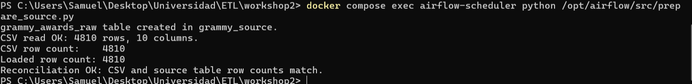
*Figure 3.1: `prepare_source.py` output: CSV 4,810 rows = table `grammy_awards_raw` 4,810 rows (`Reconciliation OK`).*

**Evidence: Grammy data is extracted from the database, not from the CSV.** The log of `extract_grammys` in the Test A run (`manual__2026-10-12T18:03:51`) records the query against `grammy_source.grammy_awards_raw`: [`docs/evidence/user_runs/testA_extract_grammys.log`](docs/evidence/user_runs/testA_extract_grammys.log) (E03). The task has no access to `data/the_grammy_awards.csv`; only `src/prepare_source.py` reads that file.

---

## 4. Pipeline architecture

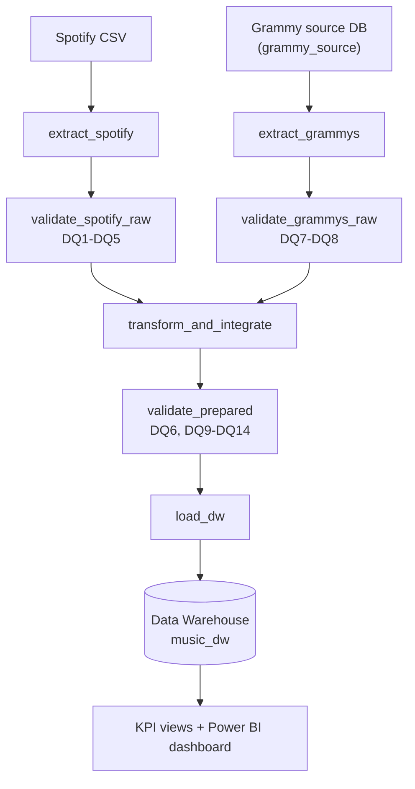

| Layer | Component | Responsibility |
|---|---|---|
| Orchestration | `dags/reliable_music_pipeline.py` | Workflow structure, dependencies, retry and failure policy (TaskFlow API) |
| Reusable logic | `src/extract.py`, `validation.py`, `transform.py`, `load.py`, `db.py` | Extraction, validation, transformation and load, testable without Airflow |
| Quality design | Profiling -> quality risks -> quality rules -> Great Expectations -> validation gates | Sections 5-7 |
| Reliability controls | Dependencies, selective retries, logs, controlled failure, atomic idempotent load | Sections 10-14 |
| Infrastructure | `docker-compose.yaml` | Airflow 3.1.8 (API server, scheduler, triggerer, worker, Redis, metadata DB) and PostgreSQL 16 (`music_postgres`) |

**Task interfaces.** Tasks exchange only compact metadata (file paths, batch id, row counts, rule ids). Bulk data moves through staging parquet files in `data/staging/<run_id>/`; the Airflow metadata database is never used as a data transport. The staging files also preserve the evaluated batch for investigation.

---

## 5. Data profiling findings

Reproducible notebook: [`notebooks/data_profiling.ipynb`](notebooks/data_profiling.ipynb) (executed, outputs included). Profiling only observes; it never alters data.

| Dataset / attribute | Profiling evidence | Potential quality risk | Related requirement |
|---|---|---|---|
| Spotify `duration_ms` | 1 row of 114,000 equals 0 | Impossible value | R1-R3 (DQ1) |
| Spotify `track_name`, `artists` | The same row has both null | Missing match key | R1-R3 (DQ3) |
| Spotify audio features, `popularity` | All within [0,1] and [0,100] | A source schema or unit change would break them | R1, R2 (DQ2, DQ4) |
| Spotify `track_id` + `track_genre` | 24,259 repeated `track_id` (a song tagged under several genres: expected); 450 exact repeated pairs | Double counting in averages and genre counts | R1, R3 (DQ5) |
| Grammy `artist` | 1,840 nulls (38.3%) | Nomination can never be matched | Scope of R1-R3 |
| Grammy `category` | 638 labels; 9 are redundant spellings (case, spacing, wording) | One category split into several | R3 (DQ6) |
| Grammy `winner` | `True` in 100% of rows; up to 2 rows per category-year before 2011, up to 8 from 2011 | The flag does not identify the winner among nominees | Evidence only (DQ8) |
| Cross-source | A naive join on (title, artist) returns 443 rows for 181 distinct nominations; real match rate is 5.5% | Fan-out inflates `fact_nomination` | R2, R3 (DQ9, DQ10) |

---

## 6. Quality risks and quality rules

Fourteen rules, each justified by profiling evidence, an analytical requirement or a post-transformation invariant. Full specification in [`docs/quality_rules.md`](docs/quality_rules.md).

| Rule | Layer | Dimension | What must be true | Threshold | Severity | Requirement |
|---|---|---|---|---|---|---|
| DQ1 | Spotify raw | Validity | `duration_ms` > 0 | <= 0.1% violations | Critical | R1-R3 |
| DQ2 | Spotify raw | Validity | `popularity` in [0,100] | 0 violations | Critical | R2 |
| DQ3 | Spotify raw | Completeness | `track_name`, `artists` not null | <= 0.1% nulls | Critical | R1-R3 |
| DQ4 | Spotify raw | Validity | 7 audio features in [0,1] | 0 violations | Critical | R1 |
| DQ5 | Spotify raw | Uniqueness | (`track_id`, `track_genre`) unique | 0 duplicates | Warning | R1, R3 |
| DQ6 | Prepared | Consistency | `category_normalized` non-null, one label per category | 0 violations | Critical | R3 |
| DQ7 | Grammy raw | Validity | `year` in [1958, 2026] | 0 violations | Critical | R3 |
| DQ8 | Grammy raw | Consistency | `winner` flag reliable (single-row groups) | >= 70% of rows (observed 89.7%) | Warning | Evidence |
| DQ9 | Prepared | Consistency | Match rate within the observed band | 4%-15% (observed 5.5%) | Informational | R2, R3 |
| DQ10 | Prepared | Uniqueness | One prepared row per source nomination (no join fan-out) | 0 duplicates | Critical | R2, R3 |
| DQ11 | Prepared | Uniqueness | (`track_id`, `track_genre`) unique after deduplication | 0 duplicates | Critical | R1, R3 |
| DQ12 | Prepared | Integrity | Every matched `track_id` exists in prepared tracks | 0 orphans | Critical | R2, R3 |
| DQ13 | Prepared | Structure | Required columns present | 0 missing | Critical | R1-R3 |
| DQ14 | Prepared | Validity | After quarantine: no `duration_ms <= 0`, no null match key | 0 violations | Critical | R1-R3 |

**Severity policy.** *Critical*: the task fails and the downstream path is blocked, with no retry. *Warning*: logged and recorded in the result JSON, the pipeline continues. *Informational*: recorded for monitoring only.

**Threshold rationale.**
- **DQ1, DQ3 (<= 0.1%):** profiling found a single offending row (about 0.001%). The tolerance lets the pipeline quarantine isolated defects (T2) while still stopping systemic corruption; Test B injects 5% and fails.
- **DQ2, DQ4, DQ7, DQ10-DQ14 (zero tolerance):** bounded domains, key integrity and structural invariants. Any violation means a schema change, a unit change or a transformation bug.
- **DQ5 (Warning):** repeated pairs are expected to exist in the source and are resolved by deduplication (T3), so they need visibility but do not invalidate the batch.
- **DQ8 (>= 70%) and DQ9 (4%-15%):** set with margin around the observed values (89.7% and 5.5%) so that a material degradation of the winner flag or of the match rate is surfaced. Both are non-blocking by design.

---

## 7. Great Expectations validation design

Implemented in `src/validation.py`. One gate = one Checkpoint run over a whole-DataFrame batch.

| Design element | Implementation |
|---|---|
| Expectation | One GX check per declared rule; `meta` carries `rule_id` and `severity` |
| Expectation Suites | `spotify_raw_suite`, `grammy_raw_suite`, `prepared_tracks_suite`, `prepared_nominations_suite` |
| Validation Definitions | `<prefix>_validation` = suite + whole-DataFrame batch definition |
| Checkpoints | `<prefix>_checkpoint`, run by the validation functions |
| Validation result | JSON in `results/validation/<run_id>__<suite>.json` |
| Policy | Evaluated **per rule** (by severity), not through GX's global `success` flag |

**Rule -> Expectation mapping**

| Rule | Suite | GX Expectation |
|---|---|---|
| DQ1 | `spotify_raw_suite` | `ExpectColumnValuesToBeBetween(duration_ms, min_value=0, strict_min=True, mostly=0.999)` |
| DQ2 | `spotify_raw_suite` | `ExpectColumnValuesToBeBetween(popularity, 0, 100)` |
| DQ3 | `spotify_raw_suite` | `ExpectColumnValuesToNotBeNull(track_name, artists; mostly=0.999)` |
| DQ4 | `spotify_raw_suite` | `ExpectColumnValuesToBeBetween(<7 audio features>, 0, 1)` |
| DQ5 | `spotify_raw_suite` | `ExpectCompoundColumnsToBeUnique(track_id, track_genre)` |
| DQ6 | `prepared_nominations_suite` | `ExpectColumnValuesToNotBeNull(category_normalized)` + `ExpectColumnValuesToBeInSet(category_label_consistent, [True])` |
| DQ7 | `grammy_raw_suite` | `ExpectColumnValuesToBeBetween(year, 1958, 2026)` |
| DQ8 | `grammy_raw_suite` | `ExpectColumnValuesToBeInSet(winner_flag_reliable, [True], mostly=0.70)` |
| DQ9 | `prepared_nominations_suite` | `ExpectColumnMeanToBeBetween(is_matched_to_spotify_int, 0.04, 0.15)` |
| DQ10 | `prepared_nominations_suite` | `ExpectColumnValuesToBeUnique(grammy_row_id)` |
| DQ11 | `prepared_tracks_suite` | `ExpectCompoundColumnsToBeUnique(track_id, track_genre)` |
| DQ12 | `prepared_nominations_suite` | `ExpectColumnValuesToBeInSet(fk_valid, [True])` |
| DQ13 | both prepared suites | `ExpectTableColumnsToMatchSet(<required columns>, exact_match=False)` |
| DQ14 | `prepared_tracks_suite` | `ExpectColumnValuesToBeBetween(duration_ms, strict_min=0)` + `ExpectColumnValuesToNotBeNull(track_name, artists)` |

---

## 8. Transformation and integration strategy

Implemented in `src/transform.py`; decision record in [`docs/transformation_integration.md`](docs/transformation_integration.md).

| ID | Rule | Evidence | Effect |
|---|---|---|---|
| T1 | Drop the `Unnamed: 0` column | Index artifact | 21 -> 20 columns |
| T2 | **Quarantine** rows with `duration_ms <= 0` or null keys (kept aside, not silently repaired) | DQ1, DQ3 | 1 row quarantined |
| T3 | Deduplicate (`track_id`, `track_genre`), keep highest popularity | DQ5 | 450 duplicates removed |
| T4 | Normalize Grammy category labels (case, spacing) | DQ6 | 638 -> 629 categories |
| T5 | Derive `is_confirmed_winner` | DQ8 | 4,315 confirmed winners |
| T6 | Integrate Grammy with Spotify | R1-R3 | 263 nominations linked |

**Integration contract**

| Item | Decision |
|---|---|
| Keys | Spotify `track_name` + `artists` <-> Grammy `nominee` + `artist` |
| Preprocessing | Exact tier uses raw values; normalized tier applies title cleaning and primary-artist extraction |
| Strategy | Two tiers recorded in `match_type`: **exact**, then **normalized** |
| Cardinality | Many-to-one: each nomination maps to at most one track |
| Unmatched | 4,547 of 4,810 (94.5%) kept with NULL track key |
| Duplicate matches | 79 linked nominations had several candidates: highest popularity wins and the row is flagged `match_ambiguous` |
| Assumptions and limitations | See [Section 17](#17-assumptions-and-limitations) |

**Reconciliation evidence** (written to `results/reconciliation/` on each run)
- Spotify: 114,000 = 113,549 prepared + 1 quarantined + 450 duplicates removed
- Grammy: 4,810 = 4,810 prepared
- Matches: exact (181) + normalized (82) + none (4,547) = 4,810
- Task log with these counts: [`docs/evidence/user_runs/rerun_transform_and_integrate.log`](docs/evidence/user_runs/rerun_transform_and_integrate.log) (E25), including 79 ambiguous matches, 231 distinct nominated tracks and 4,315 confirmed winners.

---

## 9. Dimensional model

Executable schema: [`sql/dw_schema.sql`](sql/dw_schema.sql). Documentation: [`docs/dimensional_model.md`](docs/dimensional_model.md).

Fact constellation with **two facts sharing the conformed dimension `dim_track`**.

| Fact / Dimension | Grain / Description | Keys | Rows |
|---|---|---|---|
| `fact_track` | One track under one genre tag | PK (`track_key`, `genre_key`) | 113,549 |
| `fact_nomination` | One nomination (linked or unlinked) | PK `nomination_id`, FK `track_key` (nullable) | 4,810 |
| `dim_track` | Conformed track identity | PK `track_key`, BK `track_id` | 89,740 |
| `dim_genre` | Spotify genre | PK `genre_key`, BK `genre_name` | 114 |
| `dim_category` | Grammy category | PK `category_key`, BK `category_name` | 629 |
| `dim_year` | Ceremony year | PK `year` | 62 |

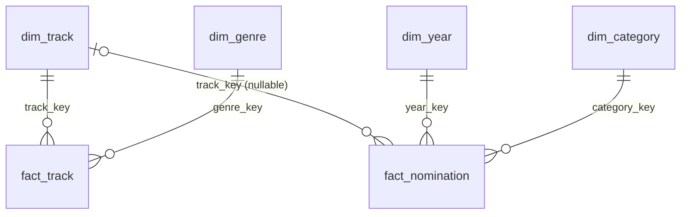

---

## 10. Airflow DAG design

`dags/reliable_music_pipeline.py` (DAG `reliable_music_pipeline`, TaskFlow API with `from airflow.sdk import dag, task`). Seven tasks, two independently observable source branches that converge at `transform_and_integrate`. `validate_prepared` gates `load_dw`.

| Task | Module | Retries | Rationale |
|---|---|---|---|
| `extract_spotify` | `src.extract` | 1 (15 s) | Transient file I/O |
| `extract_grammys` | `src.extract` | 3 (backoff) | Transient database connection outage |
| `validate_spotify_raw` | `src.validation` | 0 | Deterministic gate |
| `validate_grammys_raw` | `src.validation` | 0 | Deterministic gate |
| `transform_and_integrate` | `src.transform` | 0 | Deterministic computation |
| `validate_prepared` | `src.validation` | 0 | Deterministic gate |
| `load_dw` | `src.load` | 2 (1 min) | Transient connection errors only; the load is one atomic transaction, so a retry is safe |

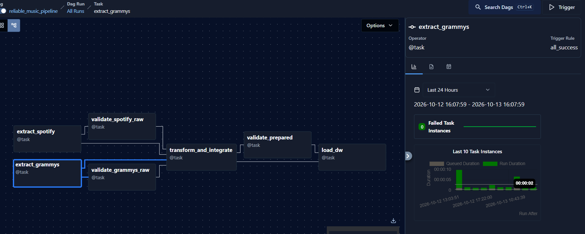
*Figure 10.1: Graph view of `reliable_music_pipeline`: two source branches (`extract_*` -> `validate_*_raw`) converge at `transform_and_integrate`, followed by `validate_prepared` and `load_dw`.*

Retries are applied only to tasks exposed to transient operational failures. Every task that can only fail for deterministic data or contract reasons is configured without retry. The task logs record the configured values: `max_tries=2` for `load_dw` (E22) and `max_tries=0` for `transform_and_integrate` (E25). A deterministic failure in a task that does have retries (`load_dw` in Test C) is raised as `AirflowFailException` and ends on try 1 (E23).

---

## 11. Failure and retry policy

| Condition | Severity / type | Pipeline response | Retry? | Justification |
|---|---|---|---|---|
| Temporary database or network outage during extraction | Transient operational | Retry with backoff; fail the task if attempts are exhausted | Yes (`extract_grammys` 3, `extract_spotify` 1) | Another attempt can succeed without changing input or code |
| Temporary connection error during load | Transient operational | Retry; the transaction rolls back, leaving the DW unchanged | Yes (`load_dw` 2, 1 min) | The atomic load makes retries safe |
| Permanent database error (for example, target database missing) | Deterministic operational | Fail the task with the error visible in the log; no data written | No | Retrying cannot fix it; evidence in E15 |
| Critical raw rule fails (DQ1-DQ4, DQ7) | Critical, deterministic | Gate task fails; downstream tasks end as `upstream_failed`; result JSON and log kept | No | Repetition reproduces the same failure |
| Critical prepared rule fails (DQ6, DQ10-DQ14) | Critical, deterministic | `validate_prepared` fails; `load_dw` does not run; DW untouched | No | Loading would corrupt the analytical target |
| Warning rule fails (DQ5, DQ8) | Warning | Logged and recorded; pipeline continues | n/a | Needs visibility but does not invalidate the batch |
| Informational rule outside band (DQ9) | Informational | Recorded for monitoring | n/a | Trend signal only |
| Reconciliation mismatch in transformation | Integrity breach | Fail `transform_and_integrate` | No | Row counts must be explainable |
| Failure in the middle of the load | Operational | Transaction rolls back (design guarantee) and the previous DW state remains | After the cause is fixed | Atomic replace prevents partial loads |

### Logging and observability

| Question | Evidence |
|---|---|
| What ran? | DAG run and task identifiers in the Grid view (Figures 12.1, 13.1) |
| When? | Run time and task start/end timestamps (Figures 13.2, 14.1) |
| Did it succeed? | DAG and task states plus row counts (Figure 12.2) and `etl_load_audit` (Figure 14.3) |
| Where did it fail? | Failed task and `upstream_failed` downstream tasks (Figures 13.1, 13.3) |
| Why? | Task logs (E06, E09) and the per-rule GX JSON (E07, E10) with rule id and violation count |
| What happened next? | No retry for deterministic failures (Figure 13.2); policy table above |

---

## 12. Successful execution evidence (Test A)

Full end-to-end execution on a valid batch. All 7 tasks complete successfully, reconciliation evidence is recorded (Section 8) and the dashboard reads the loaded data (Section 15).

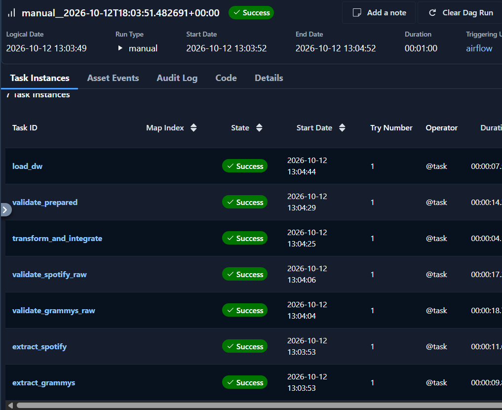
*Figure 12.1: Task instances of the Test A run (`manual__2026-10-12T18:03:51`): all 7 tasks succeeded on try 1.*

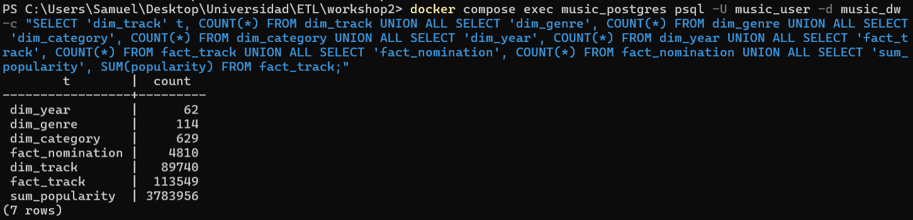
*Figure 12.2: Verification query on `music_dw` showing row counts for facts and dimensions.*

| Table | Rows |
|---|---|
| `dim_track` | 89,740 |
| `dim_genre` | 114 |
| `dim_category` | 629 |
| `dim_year` | 62 |
| `fact_track` | 113,549 |
| `fact_nomination` | 4,810 |
| `etl_load_audit` | 1 record (`status = 'SUCCESS'`) |

---

## 13. Controlled failure evidence (Test B and B2)

Faults are injected through DAG parameters (see [Section 16](#reproducing-the-reliability-tests)), so the failure is deliberate, repeatable and linked to a rule id.

### Test B: Critical raw-gate failure (DQ1)

Condition: `inject_spotify_fault = spotify_duration_ms_zero` sets 5% of `duration_ms` to 0.

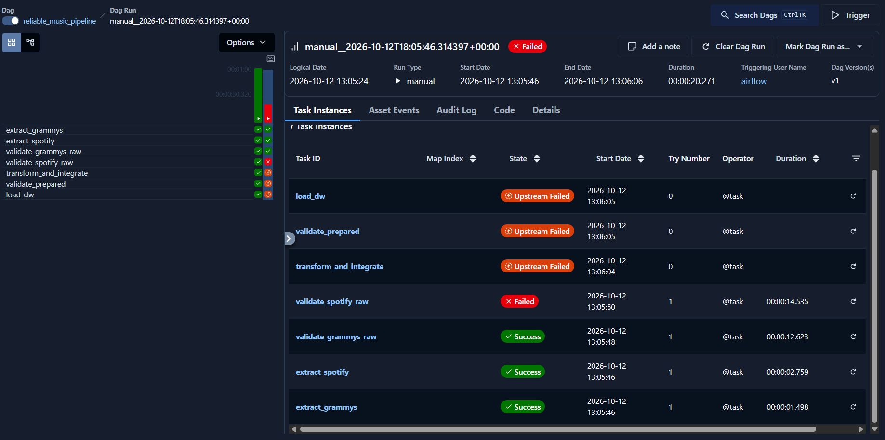
*Figure 13.1: Run `manual__2026-10-12T18:05:46`: `validate_spotify_raw` failed on try 1 and the three downstream tasks are `upstream_failed`. The Grammy branch succeeded independently.*

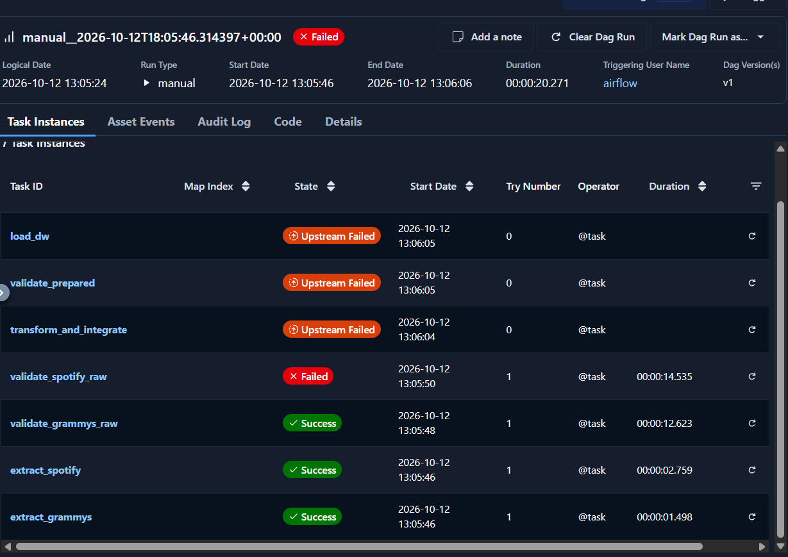
*Figure 13.2: Task instances confirm no retry for the deterministic failure and that `transform_and_integrate`, `validate_prepared` and `load_dw` never started (try 0).*

**Failed task log and GX validation result** (run `manual__2026-10-13T15:19:14`, same injected condition):
- Task log: 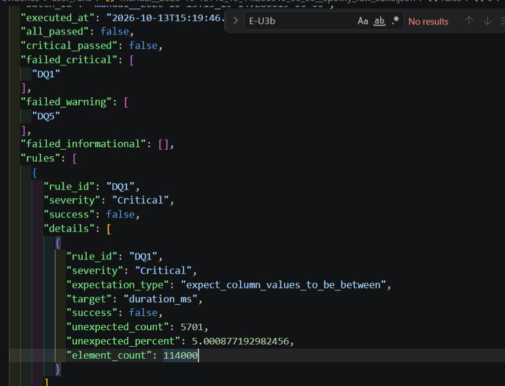 It shows `DQ5` as a Warning (pipeline continues) followed by `BLOCKED by Critical rule(s) ['DQ1']`.
- GX result: [`docs/evidence/validation_results/manual__2026-10-13T15_19_14.286019_00_00__spotify_raw_suite.json`](docs/evidence/validation_results/manual__2026-10-13T15_19_14.286019_00_00__spotify_raw_suite.json). `DQ1`: 5,701 of 114,000 rows invalid (5.00%) against a 0.1% threshold; `critical_passed: false`.

**Explanation.** `extract_spotify` succeeds because extraction does not hide source-quality problems. `validate_spotify_raw` evaluates DQ1, measures 5.00% and fails with `AirflowFailException`. `transform_and_integrate`, `validate_prepared` and `load_dw` do not run, so the Data Warehouse is untouched and no audit row is written. The same run also shows the Warning policy: DQ5 failed (0.78%), was logged and did not block the gate.

### Test B2: Critical prepared-gate failure (DQ10)

Condition: `inject_prepared_fault = join_fanout` simulates a join that duplicates nominations (5,000 prepared rows instead of 4,810).

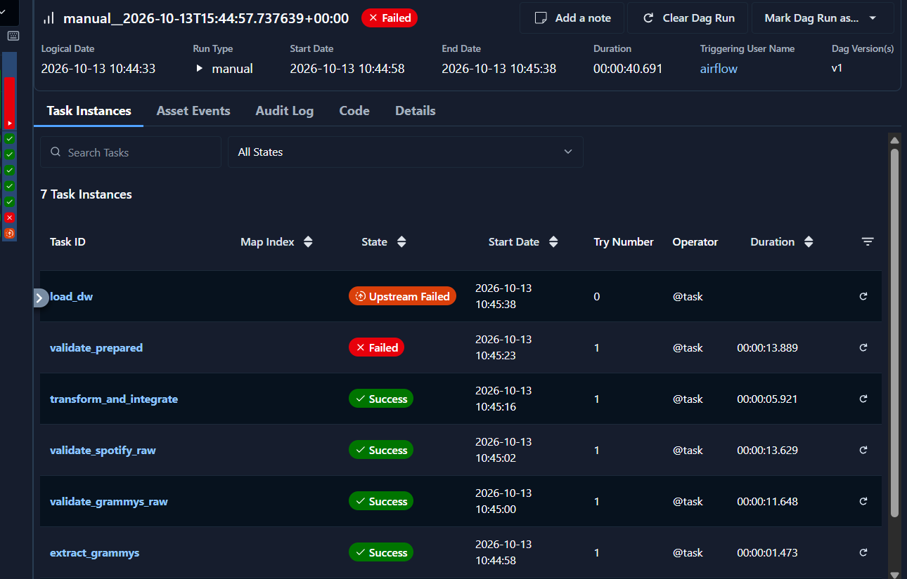
*Figure 13.3: Run `manual__2026-10-13T15:44:57`: extraction, both raw gates and `transform_and_integrate` succeeded; `validate_prepared` failed and `load_dw` is `upstream_failed`.*

**Failed task log and GX validation result** (same run):
- Task log: 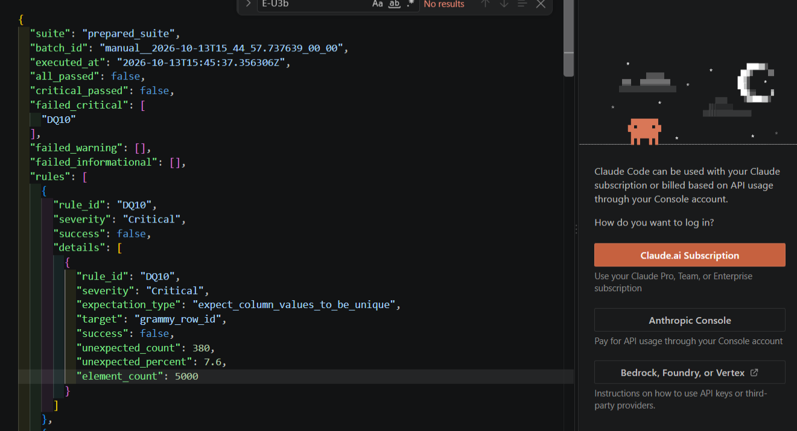 It shows `BLOCKED by Critical rule(s) ['DQ10']. Downstream tasks will not run.`
- GX result: [`docs/evidence/validation_results/manual__2026-10-13T15_44_57.737639_00_00__prepared_suite.json`](docs/evidence/validation_results/manual__2026-10-13T15_44_57.737639_00_00__prepared_suite.json). `DQ10`: 380 of 5,000 rows duplicated (7.6%) against a zero threshold; every other prepared rule passed.

**Explanation.** The prepared gate detects more than one row per source nomination. `load_dw` is gated by this Critical outcome and never executes, so the warehouse keeps its previous state (the audit table shows no load for this batch).

---

## 14. Repeatability strategy (safe rerun)

**Strategy: atomic replace.** `load_dw` truncates and reloads all warehouse tables inside a **single SQL transaction**, and records the attempt in `etl_load_audit`.

- **Rerun with the same batch:** the replace produces the same state, so there are no duplicate rows. Primary keys on every table act as a second barrier.
- **Failed run before the load (Tests B and B2):** `load_dw` never starts, so the warehouse keeps its previous state and no audit row is written. Evidence: [`dw_counts_and_audit_after_two_loads.txt`](docs/evidence/user_runs/dw_counts_and_audit_after_two_loads.txt) (no audit row for the Test B run) and Figure 14.3 (no row for the Test B2 batch).
- **Failure during the load:** the truncate and every insert run inside one transaction (`engine.begin()`). Any exception rolls everything back, leaving the previous complete state, and a separate transaction then writes a `FAILED` row to `etl_load_audit` (the audit insert can never mask the original error). `load_dw` accepts a `fail_after` option (`dims` or `fact_track`) that raises a simulated error mid-load to exercise this path (Test C below).
- **Failure before the database exists (first Docker run):** `load_dw` failed visibly with no partial data (E15). The cause was fixed by creating the DW database when it is missing.

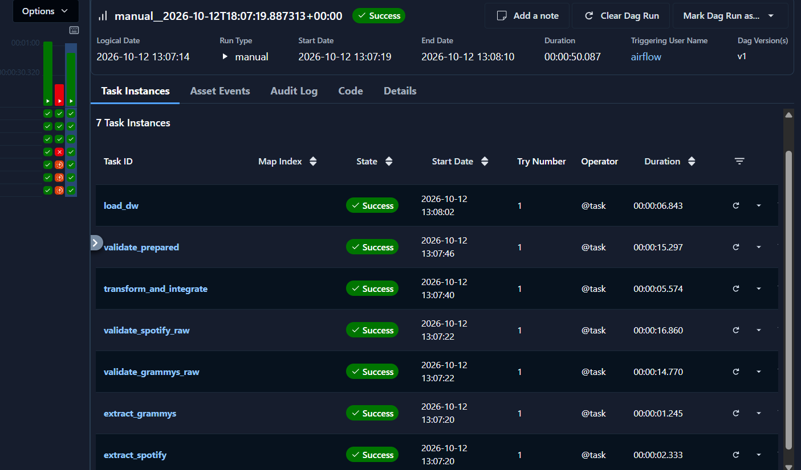
*Figure 14.1: Successful rerun of the same batch.*

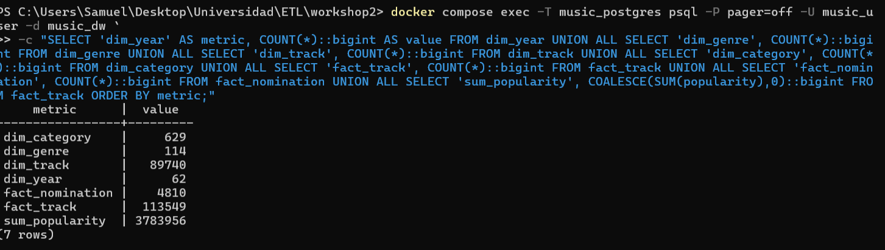
*Figure 14.2: Row counts and `SUM(popularity)` after the reruns are identical to those of Test A (Figure 12.2).*

The `load_dw` log of the rerun ([`rerun_load_dw.log`](docs/evidence/user_runs/rerun_load_dw.log), E22) records the same counts before and after the replace (`fact_track` 113,549; `fact_nomination` 4,810; `SUM(popularity)` 3,783,956; 263 linked nominations), followed by `DW load committed`.

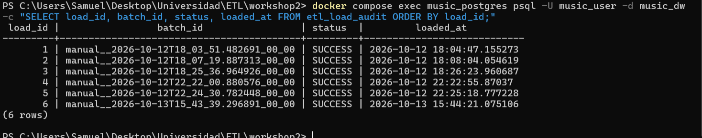
*Figure 14.3: `etl_load_audit` with six `SUCCESS` loads. Loads 1 and 2 are Test A and the rerun; the failed runs (Tests B and B2) wrote no row.*

| Table / metric | After Test A (load 1) | After rerun (load 2) |
|---|---|---|
| `fact_track` | 113,549 | 113,549 |
| `fact_nomination` | 4,810 | 4,810 |
| `SUM(popularity)` | 3,783,956 | 3,783,956 |
| `etl_load_audit` | 1 `SUCCESS` | 2 `SUCCESS` |

An append would have produced 227,098 and 9,620 rows; the counts stay at one snapshot.

### Test C: controlled failure during the load

Condition: a simulated error is raised after `fact_track` has been loaded (`fail_after = fact_track`), the worst mid-load point short of the last table.

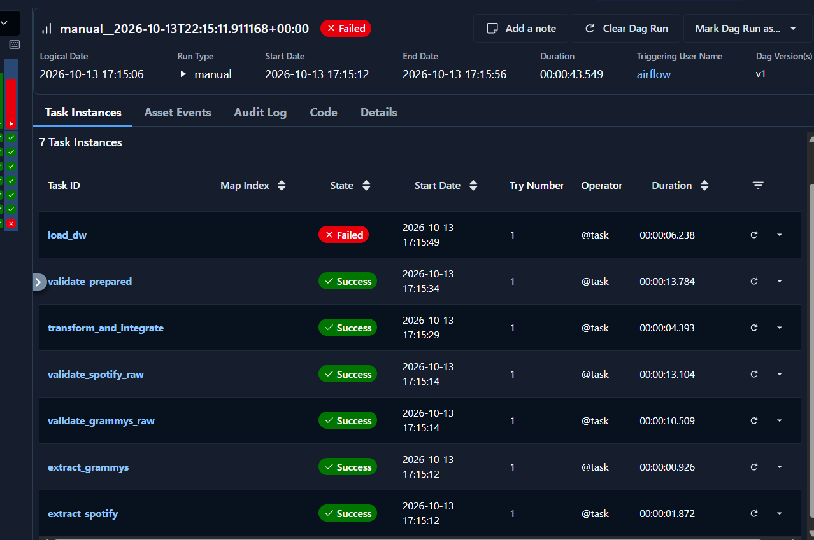
*Figure 14.4: Run `manual__2026-10-13T22:15:11`: extraction, both raw gates, transformation and `validate_prepared` succeeded; `load_dw` failed on try 1, so there was no retry.*

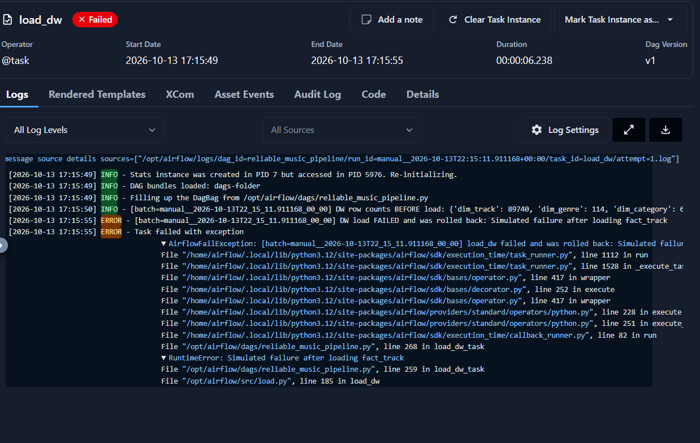
*Figure 14.5: `load_dw` log: row counts logged before the load, then `DW load FAILED and was rolled back: Simulated failure after loading fact_track`.*

**Explanation.** The error is raised inside the transaction after the truncate and after four dimensions plus `fact_track` were written. The log states that the load was rolled back, so the warehouse is not left with a half-loaded state. The task failed on its first try without retries: the error is deterministic, so repeating it would reproduce it, and the failure is surfaced as `AirflowFailException` instead of being retried.

**Load logic** (`src/load.py`, lines 171-221): the transaction truncates, reloads, verifies **before commit** (row counts and a `SUM(popularity)` checksum against the prepared data) and writes the audit row in the same transaction. The row counts before the load are logged (`DW row counts BEFORE load`).

```python
try:
    with engine.begin() as conn:
        before = {t: _count(conn, t) for t in TABLE_ORDER}
        logger.info("[batch=%s] DW row counts BEFORE load: %s", batch_id, before)

        conn.execute(text("TRUNCATE fact_nomination, fact_track, dim_track, dim_genre, dim_category, dim_year"))
        for t in ["dim_track", "dim_genre", "dim_category", "dim_year"]:
            _copy_df(conn, t, model[t])
        if fail_after == "dims":
            raise RuntimeError("Simulated failure after loading dimensions")
        _copy_df(conn, "fact_track", model["fact_track"])
        if fail_after == "fact_track":
            raise RuntimeError("Simulated failure after loading fact_track")
        _copy_df(conn, "fact_nomination", model["fact_nomination"])

        # Verification BEFORE commit: any mismatch raises -> full rollback
        after = {t: _count(conn, t) for t in TABLE_ORDER}
        expected = {t: int(len(model[t])) for t in TABLE_ORDER}
        if after != expected:
            raise ValueError(f"Row count mismatch after load: loaded={after} expected={expected}")
        pop_sum = int(conn.execute(text("SELECT COALESCE(SUM(popularity), 0) FROM fact_track")).scalar())
        if pop_sum != int(model["fact_track"]["popularity"].sum()):
            raise ValueError("Measure checksum mismatch (SUM popularity) after load")
        # ... summary dict, then INSERT INTO etl_load_audit (..., 'SUCCESS', summary)
except Exception as exc:
    logger.error("[batch=%s] DW load FAILED and was rolled back: %s", batch_id, exc)
    # separate transaction: INSERT INTO etl_load_audit (batch_id, status, error) VALUES (..., 'FAILED', ...)
    raise
```

---

## 15. Dashboard and analytical outputs

The Power BI report ([`dashboard/music_dashboard.pbix`](dashboard/music_dashboard.pbix)) connects directly to `music_dw` through PostgreSQL views defined in [`sql/kpi_queries.sql`](sql/kpi_queries.sql). No CSV is used as a dashboard source.

| Requirement | DW element / query | KPI / visualization |
|---|---|---|
| R1 | `kpi_r1_audio_profile_overall` (`fact_track`, `dim_track`, `dim_genre`, `fact_nomination`) | KPI-1: audio profile, nominated vs. rest (bar chart) |
| R2 | `kpi_r2_popularity_summary` (`fact_track`, `fact_nomination`) | KPI-2: average and median popularity, share >= 50 (cards and histogram) |
| R3 | `kpi_r3_genre_by_decade` (`fact_nomination`, `dim_year`, `dim_genre`) | KPI-3: nominations per genre and decade (stacked chart) |


*Figure 15.1: Power BI connected to the `music_dw` database, selecting the KPI views.*


*Figure 15.2: Dashboard answering R1, R2 and R3 from warehouse data.*

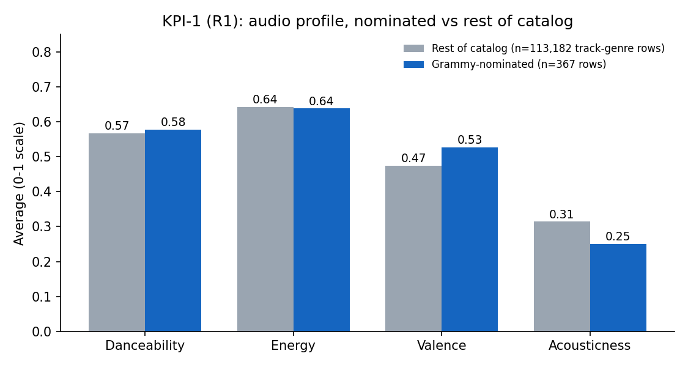
*Figure 15.3: KPI-1 (R1): audio characteristics of Grammy-nominated songs vs. the rest of the catalog.*

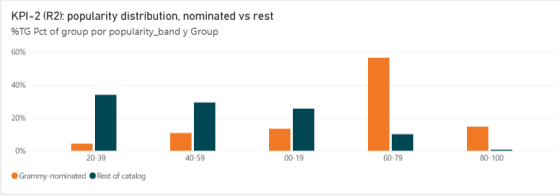
*Figure 15.4: KPI-2 (R2): nominated tracks average popularity 59.1 vs. 33.1 for the rest.*

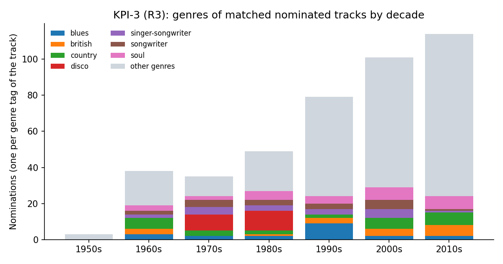
*Figure 15.5: KPI-3 (R3): top nominated genres by decade (1950s-2010s).*

---

## 16. Setup and execution instructions

### Prerequisites
- Docker Desktop with at least 4 GB RAM and 2 CPUs.
- Ports 8080 (Airflow) and 5433 (PostgreSQL `music_postgres`) free.
- Original input files in `data/` (`spotify_dataset.csv`, `the_grammy_awards.csv`).

### Step by step

```bash
# 1. Environment configuration (edit .env if you want different credentials)
cp .env.example .env

# 2. Build the Airflow image with Great Expectations
docker compose build

# 3. Initialize Airflow metadata
docker compose up airflow-init

# 4. Start the stack
docker compose up -d

# 5. Confirm the Airflow version (expected: 3.1.8)
docker compose exec airflow-scheduler airflow version

# 6. Source preparation: load the Grammy CSV into the source database
docker compose exec airflow-scheduler python /opt/airflow/src/prepare_source.py

# 7. Open the Airflow UI at http://localhost:8080 and trigger DAG: reliable_music_pipeline
#    (credentials are defined in .env.example)
```

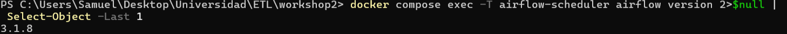
*Figure 16.1: `airflow version` inside the scheduler container reports 3.1.8.*

### Verification query

```bash
docker compose exec music_postgres psql -U music_user -d music_dw -c \
"SELECT 'fact_track' t, COUNT(*) FROM fact_track UNION ALL SELECT 'fact_nomination', COUNT(*) FROM fact_nomination;"
```

### Reproducing the reliability tests

Use **Trigger DAG w/ config** in the Airflow UI and set the parameter:

| Test | Parameter | Value | Expected result |
|---|---|---|---|
| A (success) | none | default | All 7 tasks succeed |
| B (raw gate) | `inject_spotify_fault` | `spotify_duration_ms_zero` | `validate_spotify_raw` fails (DQ1); downstream blocked |
| B2 (prepared gate) | `inject_prepared_fault` | `join_fanout` | `validate_prepared` fails (DQ10); `load_dw` blocked |
| C (load fault) | load-failure parameter in the trigger form | `fact_track` (`dims` fails earlier) | `load_dw` fails and rolls back; no retry |
| Safe rerun | none | trigger a second default run | Same row counts and measures |

Secrets are never committed: `.env` is ignored by Git and `.env.example` documents the required variables without real credentials.

---

## 17. Assumptions and limitations

1. **Match precision.** Matching uses normalized title and primary artist. Unmatched nominations (94.5%) stay in `fact_nomination` with `track_key = NULL`. Featured-artist spellings or alternative titles can cause missed matches.
2. **Nomination grain.** Only track-level nominations can be matched. Albums, producers and classical categories remain unlinked by design.
3. **Winner flag.** The source `winner` column is `True` for every row and cannot identify winners on its own; `is_confirmed_winner` is a derived approximation (DQ8).
4. **Temporal mismatch.** Popularity reflects the current Spotify snapshot, whereas Grammy nominations cover 1958-2019.
5. **Full reload.** Safe rerun relies on atomic replace; incremental or delta processing is out of scope.

---

## 18. Traceability, evidence register and compliance map

### 18.1 End-to-end traceability matrix

| Requirement | Required data | Quality risk | DQ rule | GX Expectation | Transformation | DW element | KPI / visualization |
|---|---|---|---|---|---|---|---|
| R1 | Audio features, genre, nomination | Zero duration; features out of bounds; duplicated pairs | DQ1, DQ4, DQ5, DQ11, DQ14 | `ExpectColumnValuesToBeBetween`, `ExpectCompoundColumnsToBeUnique` | T2 quarantine, T3 deduplication, T6 join | `fact_track`, `dim_genre` | KPI-1 bar chart |
| R2 | Popularity, `track_id`, nomination | Popularity out of range; join fan-out | DQ2, DQ10, DQ12 | `ExpectColumnValuesToBeBetween`, `ExpectColumnValuesToBeUnique`, `ExpectColumnValuesToBeInSet` | T3 ranking, T6 join | `fact_track`, `fact_nomination` | KPI-2 cards and histogram |
| R3 | Genre, year, category | Unnormalized labels; invalid years; orphan keys | DQ6, DQ7, DQ12 | `ExpectColumnValuesToBeInSet`, `ExpectColumnValuesToBeBetween` | T4 category normalization | `dim_year`, `dim_category`, `dim_genre` | KPI-3 stacked chart |

### 18.2 Reliability evidence register

| ID | Run / task | Artifact or path | What it proves | Related policy / rule |
|---|---|---|---|---|
| E01 | Test A, full DAG | `docs/evidence/user_runs/testA_airflow_grid_view.png` | Successful 7-task execution on try 1 | Gates pass under policy |
| E02 | Test A, `load_dw` | `docs/evidence/user_runs/testA_dw_row_counts.png` | Warehouse loaded with the expected counts | Section 9 |
| E03 | Test A, `extract_grammys` | `docs/evidence/user_runs/testA_extract_grammys.log` | Grammy data is extracted from the database, not the CSV | Source contract (Section 3) |
| E04 | Test B, Grid view | `docs/evidence/user_runs/testB_failed_run_grid_view.png` | Raw gate blocks the pipeline | DQ1, Critical |
| E05 | Test B, task instances | `docs/evidence/user_runs/testB_failed_run_task_instances.png` | No retry on a deterministic failure; downstream never started | Failure policy |
| E06 | Test B, `validate_spotify_raw` | `docs/evidence/user_runs/testB_failed_task_log.png` | Actionable log with rule id; Warning DQ5 continues, Critical DQ1 blocks | DQ1, DQ5 |
| E07 | Test B, GX result | `results/validation/manual__2026-10-13T15_19_14.286019_00_00__spotify_raw_suite.json` | Per-rule measurement: DQ1 = 5.00% | DQ1 |
| E08 | Test B2, Grid view | `docs/evidence/user_runs/testB2_prepared_gate_grid_view.png` | Prepared gate blocks `load_dw` | DQ10, Critical |
| E09 | Test B2, `validate_prepared` | `docs/evidence/user_runs/testB2_failed_task_log.png` | Fan-out detected before loading | DQ10 |
| E10 | Test B2, GX result | `results/validation/manual__2026-10-13T15_44_57.737639_00_00__prepared_suite.json` | Per-rule measurement: DQ10 = 380 duplicated rows | DQ10 |
| E11 | Rerun, task instances | `docs/evidence/user_runs/rerun_success_run_task_instances.png` | Rerun of the same batch succeeds | Repeatability |
| E12 | Rerun, SQL | `docs/evidence/user_runs/dw_counts_and_audit_after_two_loads.txt` | Counts unchanged after two loads; no audit row for the failed run | Atomic replace |
| E13 | Load audit | `docs/evidence/user_runs/etl_load_audit_history.png` | Load history: only successful loads are recorded | Atomic replace |
| E14 | Dashboard | `docs/figures/powerbi_dashboard_overview.png` | KPIs sourced from the Data Warehouse | R1-R3 |
| E15 | First Docker run, `load_dw` | `docs/evidence/user_runs/first_docker_run_load_dw_failure.txt` | Failure is visible and diagnosable; no partial data; permanent errors are not retried | Failure policy |
| E16 | Source preparation | `docs/evidence/user_runs/source_preparation_reconciliation.png` | CSV and source table both have 4,810 rows | Source contract |
| E17 | DAG structure | `docs/evidence/user_runs/dag_graph_view.png` | Two branches, two gates, convergence and gated load | Architecture (Section 4) |
| E18 | Airflow version | `docs/evidence/user_runs/airflow_version.png` | Airflow 3.1.8 | Environment |
| E19 | Test A, GX results | `results/validation/` | Passing per-rule results for both raw gates and the prepared gate | DQ1-DQ14 |
| E20 | Test A, reconciliation | `results/reconciliation/` | 114,000 = 113,549 + 1 + 450; 4,810 = 4,810; 181 + 82 + 4,547 = 4,810 | Section 8 |
| E21 | Rerun, DW state | `docs/evidence/user_runs/dw_state_after_rerun.png` | Counts and `SUM(popularity)` unchanged after reruns | Atomic replace |
| E22 | Rerun, `load_dw` log | `docs/evidence/user_runs/rerun_load_dw.log` | Row counts before the load equal the counts after it | Atomic replace |
| E23 | Test C, Task instances | `docs/evidence/user_runs/testC_load_failure_task_instances.png` | A failure during the load fails only `load_dw`, with no retry | Failure policy |
| E24 | Test C, `load_dw` log | `docs/evidence/user_runs/testC_load_failure_task_log.png` | Mid-load error is rolled back and logged with batch id | Atomic replace |
| E25 | Rerun, `transform_and_integrate` log | `docs/evidence/user_runs/rerun_transform_and_integrate.log` | Reconciliation: 114,000 = 113,549 + 1 + 450; 4,810 = 181 + 82 + 4,547; `max_tries=0` | Section 8, failure policy |

### 18.3 Compliance map

| Requirement of the brief | Where it is covered |
|---|---|
| Analytical requirements and scope statement | Section 2 |
| Spotify from CSV, Grammy from the relational database | Section 3, E03 |
| Airflow 3.1.8 with TaskFlow API (`airflow.sdk`) | Sections 10 and 16 |
| Profiling notebook and evidence for both sources | Section 5 |
| At least six quality rules with metric, threshold and severity | Section 6 (14 rules) |
| Great Expectations suites, validation definitions, checkpoints, rule mapping | Section 7 |
| Raw validation gates for both sources | Sections 6, 7 and 10 |
| Transformation and integration contract | Section 8 |
| Prepared validation gating `load_dw` | Sections 7 and 13 (Test B2) |
| Star schema in PostgreSQL | Section 9 |
| Selective retries and failure policy | Sections 10 and 11 |
| Test A, controlled failure (Test B and B2), safe rerun | Sections 12, 13 and 14 |
| At least three KPIs from the Data Warehouse | Section 15 |
| Reproducible setup, secrets excluded | Section 16 |
| Traceability matrix and evidence register | Sections 18.1 and 18.2 |

---

## Repository structure

```
workshop-2/
|-- dags/reliable_music_pipeline.py     DAG (TaskFlow API): structure, dependencies, retries, failure policy
|-- src/                                extract.py, validation.py, transform.py, load.py, prepare_source.py, db.py
|-- gx/                                 Great Expectations context and suites
|-- notebooks/data_profiling.ipynb      Reproducible profiling notebook
|-- sql/                                source_setup.sql, dw_schema.sql, kpi_queries.sql, init_music_dbs.sql
|-- docs/                               quality_rules.md, transformation_integration.md, dimensional_model.md,
|                                       powerbi_dashboard_guide.md, figures/, evidence/
|-- data/                               spotify_dataset.csv, the_grammy_awards.csv (original input files)
|-- dashboard/                          Power BI report (music_dashboard.pbix) connected to DW views
|-- results/                            Pipeline output: validation/ and reconciliation/ JSON evidence
|-- requirements.txt  Dockerfile  docker-compose.yaml  .env.example  .gitignore  README.md
```
