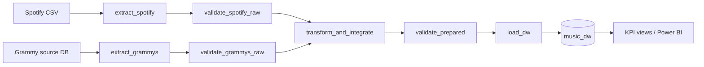

# Architecture

Complete description with rationale: README Sections 4, 9, 10 and 11. This file summarises the pattern required by the brief (Section 4.2).

| Pattern stage | Question it answers | Implementation |
|---|---|---|
| Source | Where does data come from? | Spotify CSV file; Grammy relational database (`grammy_source`), prepared once from its CSV |
| Extract | Acquire without hiding quality problems | `src/extract.py`; no cleaning |
| Raw validation | Can the data enter transformation? | `validate_spotify_raw`, `validate_grammys_raw` (DQ1-DQ5, DQ7-DQ8) |
| Transform | Clean, standardise, integrate, derive | `src/transform.py` (T1-T6) with reconciliation invariants |
| Prepared validation | Is the prepared data load-ready? | `validate_prepared` (DQ6, DQ9-DQ14); its Critical outcome gates `load_dw` |
| Load | Write the dimensional structures | `src/load.py`: atomic replace in one transaction |
| Target | Trusted Data Warehouse | `music_dw`: `fact_track`, `fact_nomination`, 4 dimensions, 5 KPI views |

| Surrounding the flow | Elements |
|---|---|
| Quality design | Profiling -> quality risks -> quality rules -> Great Expectations -> validation gates (`docs/quality_rules.md`) |
| Reliability controls | Dependencies, selective retries, logs, controlled failure, safe rerun (README Sections 10, 11, 14) |
