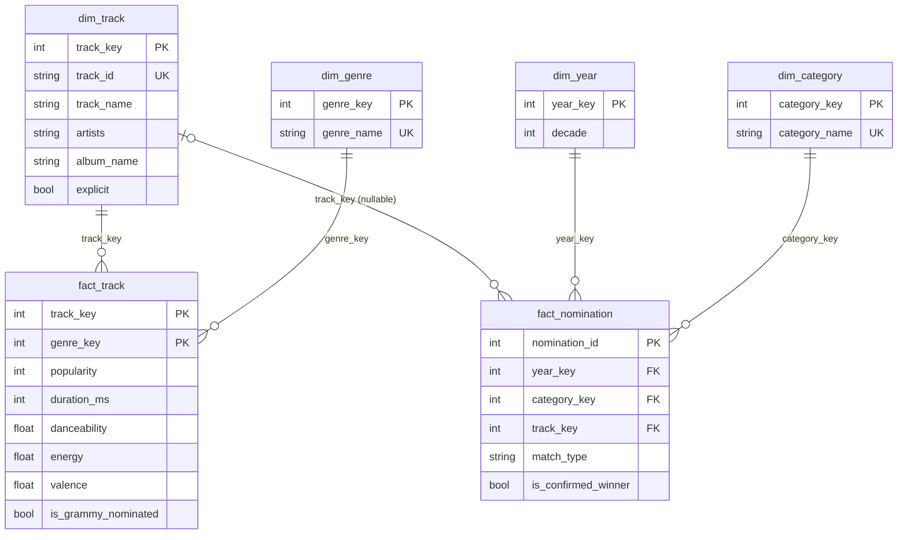

# Dimensional Model (Section 6.4)

Executable definition: `sql/dw_schema.sql`. Loader: `src/load.py`. Database: `music_dw` (PostgreSQL).

## Business processes and grain

The two sources describe two different business processes at different grains, so the model is a
**fact constellation** (two stars sharing the `dim_track` dimension) rather than a single star.
Forcing both into one fact table would either leave 99.6% of Spotify rows with empty Grammy columns
or discard 96% of the Spotify catalog that R1 needs as the comparison baseline.

| Fact table | Business process | Grain (one row represents) | Rows loaded |
|---|---|---|---|
| `fact_track` | Cataloguing of tracks on Spotify | One track under one genre tag | 113,549 |
| `fact_nomination` | Grammy nomination of a work in a category and year | One Grammy nomination, matched to a Spotify track or not | 4,810 |

## Dimensions

| Dimension | Descriptive context | Key (strategy) | Business key | Rows | Used by |
|---|---|---|---|---|---|
| `dim_track` | Identity of a song (name, artists, album, explicit). **Conformed dimension** shared by both facts | `track_key` (surrogate) | `track_id` UNIQUE | 89,740 | both facts |
| `dim_genre` | Spotify genre tag | `genre_key` (surrogate) | `genre_name` UNIQUE | 114 | `fact_track` |
| `dim_category` | Grammy category (normalized label) | `category_key` (surrogate) | `category_name` UNIQUE | 629 | `fact_nomination` |
| `dim_year` | Ceremony year and decade | `year_key` = the award year | the year itself | 62 | `fact_nomination` |

Surrogate keys are assigned by the load step in business-key order, so the same input always
produces the same keys.

## Measures

| Fact | Measure | Type | Note |
|---|---|---|---|
| `fact_track` | `popularity`, `duration_ms`, `danceability`, `energy`, `valence`, `acousticness`, `instrumentalness`, `liveness`, `speechiness`, `tempo`, `loudness` | Numeric, non-additive | Averaged, never summed across tracks |
| `fact_track` | `musical_key`, `mode`, `time_signature` | Descriptive numeric attributes | Kept on the fact, not additive |
| `fact_track` | `is_grammy_nominated` | Flag | Derived by the integration step |
| `fact_nomination` | one row = one nomination | Countable | `COUNT(*)` gives the number of nominations |
| `fact_nomination` | `is_confirmed_winner`, `winner_raw` | Flags | `winner_raw` is the untouched source value; see DQ8 |
| `fact_nomination` | `match_type`, `match_candidates`, `match_ambiguous`, `is_matched_to_spotify` | Integration quality indicators | Let each analysis choose its precision level |

## Keys and relationships

- `fact_track`: PK `(track_key, genre_key)`; FKs to `dim_track` and `dim_genre`; CHECK ranges on popularity, duration and audio features.
- `fact_nomination`: PK `nomination_id` (source row id); FKs to `dim_year`, `dim_category` and **nullable** `dim_track`. The nullable `track_key` is intentional (most nominations have no Spotify match); `CHECK ((track_key IS NULL) = (match_type = 'none'))` keeps it consistent.
- `etl_load_audit`: one row per load attempt (evidence for Section 7.3).

## How each requirement is supported

| Requirement | Query path | Verified on the loaded DW |
|---|---|---|
| R1 audio profile, nominated vs catalog, by genre | `fact_track` + `dim_genre`, split by `is_grammy_nominated`, average of audio features | Yes: 113,182 non-nominated rows vs 367 nominated rows |
| R2 popularity vs nomination | `fact_track` collapsed to one popularity per track (`MAX` per `track_key`), split by nominated flag; cross-checked against `fact_nomination` | Yes: 89,509 tracks (avg popularity 33.1) vs 231 nominated tracks (59.1) |
| R3 genres of nominees over time | `fact_nomination` (matched) + `dim_year` + `fact_track` + `dim_genre` | Yes: e.g. dance (2010s), disco (1980s) lead |

Interpretation caveats (to carry into the KPI documentation): only 231 tracks are nominated, so
differences in R1 are indicative, not conclusive; R2 compares current popularity with a past award
year; in R3 a nomination counts once per genre tag of its track.
